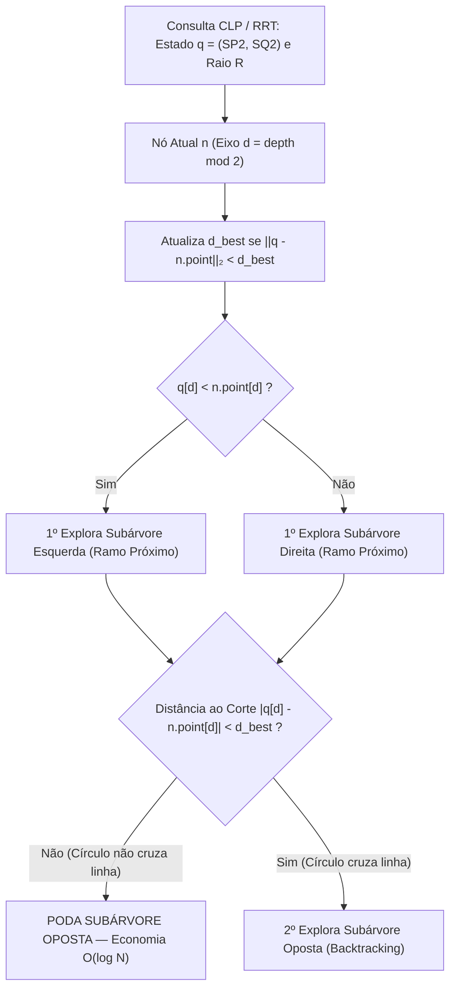

# Aula 26: Árvores KD ($k$-d Trees) na Indexação Multidimensional do SCADA-Core

### Informações do Projeto

| Parâmetro | Detalhe |
| :--- | :--- |
| **Unidade Industrial** | Linha Automatizada de Envase e Inspeção de Bebidas (Módulos 1 a 6 — Grupo 3) |
| **Aplicação** | Busca de Vizinho Mais Próximo (*Nearest Neighbor*) para o Planejador `RRT` e Busca por Raio (*Radius Search*) no Plano de Fase Hidráulico (`SP2` $\times$ `SQ2`) |
| **Método Formulado** | Árvore de Partição Espacial Multidimensional ($k$-d Tree Balanceada por Mediana) |
| **Código do Projeto** | `ECAA08-SISTEMA-SCADA-GRUPO3` |

---

## 1. Analogia Intuitiva — Por que fatiar o plano de operação da Linha de Envase?

Na **Linha Automatizada de Envase e Inspeção de Bebidas (`SCADA-Core`)**, cada instante de operação hidráulica pode ser desenhado como um ponto no plano 2D $\mathbf{p} = (P_{\text{SP2}}, Q_{\text{SQ2}})$, onde:
* **$x = P_{\text{SP2}}$** é a pressão do acumulador `AS1` (Barg);
* **$y = Q_{\text{SQ2}}$** é a vazão de dosagem no bico `VS2` (L/min).

Tanto o planejador de partida segura **RRT (Aula 22)** — que precisa executar a primitiva `NEAREST` centenas de vezes por ciclo — quanto o **Historiador SCADA-Core (Aula 21)** — que busca estados históricos parecidos para diagnóstico de anomalias (*Root Cause Analysis*) — enfrentam duas perguntas geométricas o tempo todo para um estado de consulta $\mathbf{q} = (P_{\text{SP2}}, Q_{\text{SQ2}})$:

1. **Vizinho Mais Próximo (*Nearest Neighbor Search* — NNS):** Qual ponto $\mathbf{p}^*$ já armazenado está mais próximo de $\mathbf{q}$?
2. **Busca por Raio (*Radius Search*):** Quais estados armazenados estão dentro de um círculo de raio $R$ em torno de $\mathbf{q}$ (envelope de similaridade operacional)?

Se testarmos **todos** os $N$ pontos um por um (*Força Bruta*), o custo é $\mathcal{O}(N)$ por consulta — o que fica lento quando há milhares de estados no Historiador ou centenas de iterações do RRT em tempo real.

A **Árvore KD ($k$-dimensional Tree)** resolve esse gargalo fatiando o plano de fase como uma folha de papel: primeiro faz um corte **vertical** na mediana de `SP2`, depois um corte **horizontal** na mediana de `SQ2` em cada metade, alternando os eixos até sobrar 1 ponto por região. Assim, na hora da busca, descartamos pedaços inteiros do plano de uma só vez, reduzindo o tempo médio de $\mathcal{O}(N)$ para **$\mathcal{O}(\log_2 N)$** com **100% de exatidão matemática**.

---

## 2. Formulação Matemática da Partição e da Poda Geométrica

Seja $P = \{\mathbf{p}_1, \mathbf{p}_2, \dots, \mathbf{p}_N\} \subset \mathbb{R}^k$ o conjunto de estados indexados (com $k = 2$ para o plano $(P_{\text{SP2}}, Q_{\text{SQ2}})$).

### 2.1 Construção Balanceada por Mediana

Em cada nível de profundidade $h \ge 0$ da árvore binária, o eixo de corte alterna ciclicamente:

$$d = h \bmod k \quad \in \{0, 1\} \quad (0 \equiv \text{SP2},\; 1 \equiv \text{SQ2})$$

Ordena-se o subconjunto atual pela coordenada $p^{(d)}$ e escolhe-se a **mediana** $\mathbf{p}_{\text{med}}$ como nó pivô:
* **Subárvore Esquerda ($T_{\text{esq}}$):** $\{ \mathbf{p} \in P \mid p^{(d)} < p_{\text{med}}^{(d)} \}$.
* **Subárvore Direita ($T_{\text{dir}}$):** $\{ \mathbf{p} \in P \mid p^{(d)} \ge p_{\text{med}}^{(d)} \}$.

Como cada corte divide os pontos ao meio, a árvore fica estritamente balanceada com altura mínima:

$$h(T_{\text{KD}}) = \lfloor \log_2 N \rfloor + 1$$

### 2.2 Regra de Poda de Hiperplano (*Branch-and-Bound*)

Durante a busca do vizinho mais próximo de $\mathbf{q}$, guardamos a menor distância euclidiana encontrada até agora: $r_{\text{best}} = \Vert{}\mathbf{q} - \mathbf{p}_{\text{best}}\Vert{}_2$. Em cada nó $\mathbf{p}_{\text{nó}}$ (eixo $d$):

1. Descemos primeiro pelo **ramo próximo** (o lado da linha de corte onde $\mathbf{q}$ está).
2. Ao voltar da recursão (*backtracking*), calculamos a distância perpendicular até a linha de corte:

$$\Delta_d(\mathbf{q}, \mathbf{p}_{\text{nó}}) = \left\vert{} q^{(d)} - p_{\text{nó}}^{(d)} \right\vert{}$$

3. **Critério de Poda Exata:** Como qualquer ponto $\mathbf{z}$ do outro lado da linha está a uma distância no mínimo igual a $\Delta_d$:

$$\Vert{}\mathbf{q} - \mathbf{z}\Vert{}_2 = \sqrt{\left(q^{(0)} - z^{(0)}\right)^2 + \left(q^{(1)} - z^{(1)}\right)^2} \ge \left\vert{}q^{(d)} - z^{(d)}\right\vert{} \ge \Delta_d(\mathbf{q}, \mathbf{p}_{\text{nó}})$$

* Se $\Delta_d \ge r_{\text{best}}$, o círculo de raio $r_{\text{best}}$ em torno de $\mathbf{q}$ **não cruza a linha de corte** $\implies$ **podamos toda a subárvore oposta** sem risco de perder a resposta exata.
* Na **Busca por Raio $R$**, a subárvore oposta só é visitada se $\Delta_d \le R$.

---

## 3. Fluxograma da Busca com Poda na KD-Tree (Mermaid)

---

## 4. Desempenho Experimental na Linha de Envase ($N = 500$ Estados `SP2 x SQ2`)

Na simulação do notebook com $500$ estados hidráulicos indexados e consulta no ponto nominal $\mathbf{q} = (3{,}80\text{ Barg},\, 5{,}00\text{ L/min})$:

| Métrica de Desempenho | Busca Linear (*Força Bruta*) | Árvore KD Balanceada (2D) | Ganho no SCADA-Core |
| :--- | :---: | :---: | :--- |
| **Total de Estados Indexados ($N$)** | $500$ | $500$ ($h = 9$) | Mesma base histórica / RRT |
| **Nós Inspecionados na Busca NNS** | $500$ ($100\%$) | **$10$ nós ($2{,}0\%$)** | **Poda de $98\%$ dos cálculos de distância!** |
| **Vizinho Mais Próximo Encontrado** | $(3{,}840;\, 5{,}035)$ | **$(3{,}840;\, 5{,}035)$** | **$100\%$ Exato** (erro $= 0{,}00\%$) |
| **Busca por Raio ($R = 0{,}50$)** | $9$ pontos | **$9$ pontos** | Validação idêntica em $50$ consultas aleatórias |

---

## 5. Escopo e Limitações do Modelo

1. **Maldição da Dimensionalidade (*Curse of Dimensionality*):** As Árvores KD entregam ganho máximo em baixas dimensões ($k = 2$ para `SP2 x SQ2`, ou $k = 4$ para o vetor contínuo completo `[SP2, SQ2, SP1, SQ1]` da Aula 22). Em espaços de altíssima dimensão ($k > 20$), a condição de poda quase sempre falha e o custo volta a se aproximar de $\mathcal{O}(N)$.
2. **Escalas Heterogêneas (Barg vs. L/min):** Como `SP2` varia de $0$ a $5{,}5\text{ Barg}$ e `SQ2` de $0$ a $10\text{ L/min}$, em aplicações de controle sensíveis recomenda-se normalizar as coordenadas pelos limites nominais da planta antes de construir a KD-Tree, mantendo consistência com a métrica ponderada da Aula 22.

---

## 6. Referências Técnicas

1. BENTLEY, J. L. Multidimensional binary search trees used for associative searching. **Communications of the ACM**, v. 18, n. 9, p. 509–517, 1975.
2. DE BERG, M.; CHEONG, O.; VAN KREVELD, M.; OVERMARS, M. **Computational Geometry: Algorithms and Applications**. 3rd ed. Berlin: Springer, 2008.
3. ISA — INTERNATIONAL SOCIETY OF AUTOMATION. **ANSI/ISA-5.1: Instrumentation Symbols and Identification**. Research Triangle Park, NC, 2009.
4. Grupo 3 — ECAA08. **Aula 21: Árvores Binárias (Historiador AVL); Aula 22: Rapidly-exploring Random Trees (RRT)**. UNIFEI, 2026.