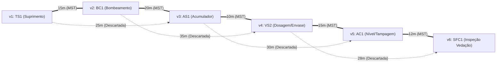

# Relatório Técnico: Otimização Topológica da Linha de Envasamento e Inspeção de Bebidas

**Dimensionamento Mínimo de Eletrocalhas de Instrumentação, Linhas Pneumáticas e Barramento SCADA-Core com Algoritmos de Kruskal e Prim**

### Informações do Projeto

| Parâmetro | Detalhe | 
| ----- | ----- | 
| **Unidade Industrial** | Linha Automatizada de Envase e Inspeção de Bebidas (Módulos 1 a 6 — Grupo 3) | 
| **Aplicação** | Interconexão de Tubulações Hidráulico-Pneumáticas (*Pipe Racks*) e Cabeamento SCADA-Core | 
| **Método Formulado** | Árvore Geradora Mínima (MST — *Minimum Spanning Tree*) | 
| **Código do Projeto** | ECAA08-SISTEMA-SCADA-GRUPO3 | 

## 1. Contextualização e Objetivo de Engenharia

No dimensionamento eletromecânico, pneumático e hidráulico de uma linha automatizada de envasamento e inspeção de bebidas (**SCADA-Core — Grupo 3**), a otimização dos leitos de tubulação sanitária em aço inox (*pipe racks*), linhas de ar comprimido para válvulas solenoides (`VS1` a `VS5`) e eletrocalhas do barramento de comunicação industrial SCADA (Modbus-RTU / 4-20 mA / 24V DC) representa um fator crítico para a minimização de CAPEX (*Capital Expenditure*) e OPEX (*Operational Expenditure*).

O objetivo deste estudo é modelar o *layout* físico das estações operacionais da linha de envase (suprimento, bombeamento, acumulação, dosagem, tampagem e inspeção sobre a esteira `RC1`) como um grafo não direcionado e valorado $G = (V, E, w)$ e determinar a topologia de interconexão de menor extensão linear contínua utilizando os algoritmos de **Kruskal** e **Prim**.

## 2. Formulação Matemática da Rede

A célula industrial de envasamento é representada por um conjunto de vértices $V$ (módulos e ativos dos setores de Suprimento, Envase e Inspeção/Qualidade) e arestas $E$ (rotas de eletrocalhas e *pipe racks* viáveis ao longo da esteira transportadora `RC1`), onde o peso $w(e)$ quantifica a distância física em metros entre os equipamentos:

* **Vértices (**$V$**):**

  * $v_1$: `TS1` — Reservatório Principal de Bebidas (Módulo de Suprimento)

  * $v_2$: `BC1` — Bomba Centrífuga de Alimentação e Sucção `VS1`/`SP1`/`SQ1` (Módulo de Pressurização)

  * $v_3$: `AS1` — Acumulador Hidráulico de Suprimento e Transmissor `SP2` (Pulmão de Estabilização)

  * $v_4$: `VS2` — Estação de Dosagem Volumétrica e Medidor de Vazão `SQ2` (Módulo de Envasamento)

  * $v_5$: `AC1` — Estação de Inspeção Óptica de Nível (`VS3`/`SL1`) e Atuador de Capping (`VS4`/`AC1`)

  * $v_6$: `SFC1` — Estação de Inspeção Final de Vedação (`VS5`/`SFC1`) sobre a Esteira `RC1`

## 3. Algoritmo de Kruskal (Abordagem Baseada em Arestas)

O algoritmo de Kruskal adota uma estratégia gulosa (*greedy*) baseada nas arestas do grafo. As rotas candidatas de eletrocalhas e tubulações são ordenadas em ordem crescente de distância métrica e inseridas na solução uma a uma, desde que não formem ciclos fechados redundantes (verificado através da estrutura de dados de conjuntos disjuntos *Union-Find*).

Para $\vert{}V\vert{} = 6$ vértices operacionais na linha de envase, a Árvore Geradora Mínima (MST) conterá exatamente $\vert{}V\vert{} - 1 = 5$ arestas.

| Ordem | Aresta $e$ | Trecho Conectado na Linha de Envase | Distância $w(e)$ | Ciclo Detectado? | Decisão de Projeto | 
| ----- | ----- | ----- | ----- | ----- | ----- | 
| 1 | $(v_3, v_4)$ | `AS1` $\leftrightarrow$ `VS2` | $10\text{ m}$ | Não | **INCLUÍDA** | 
| 2 | $(v_5, v_6)$ | `AC1` $\leftrightarrow$ `SFC1` | $12\text{ m}$ | Não | **INCLUÍDA** | 
| 3 | $(v_1, v_2)$ | `TS1` $\leftrightarrow$ `BC1` | $15\text{ m}$ | Não | **INCLUÍDA** | 
| 4 | $(v_4, v_5)$ | `VS2` $\leftrightarrow$ `AC1` | $15\text{ m}$ | Não | **INCLUÍDA** | 
| 5 | $(v_2, v_3)$ | `BC1` $\leftrightarrow$ `AS1` | $20\text{ m}$ | Não | **INCLUÍDA** | 
| 6 | $(v_1, v_3)$ | `TS1` $\leftrightarrow$ `AS1` | $25\text{ m}$ | Sim ($v_1 - v_2 - v_3$) | **REJEITADA** | 
| 7 | $(v_4, v_6)$ | `VS2` $\leftrightarrow$ `SFC1` | $28\text{ m}$ | Sim ($v_4 - v_5 - v_6$) | **REJEITADA** | 
| 8 | $(v_3, v_5)$ | `AS1` $\leftrightarrow$ `AC1` | $30\text{ m}$ | Sim ($v_3 - v_4 - v_5$) | **REJEITADA** | 
| 9 | $(v_2, v_4)$ | `BC1` $\leftrightarrow$ `VS2` | $35\text{ m}$ | Sim ($v_2 - v_3 - v_4$) | **REJEITADA** | 

**Comprimento total da infraestrutura da Linha de Envase via Kruskal:**

$$
W_{\text{Kruskal}} = 10 + 12 + 15 + 15 + 20 = 72\text{ metros}
$$

## 4. Algoritmo de Prim (Abordagem Baseada em Vértices)

O algoritmo de Prim expande uma única arborescência contínua a partir de um nó raiz inicial (definido como o Reservatório Principal de Suprimento $v_1$ / `TS1`), adicionando a cada passo a canaleta de menor distância que conecta a árvore já instalada a um módulo da fronteira ainda não cabeado.

| Iteração | Vértices na Árvore ($S$) | Arestas de Corte Elegíveis | Aresta Selecionada | Nó Adicionado | Custo | 
| ----- | ----- | ----- | ----- | ----- | ----- | 
| **Inicial** | $\{v_1\}$ | $(v_1, v_2): 15$, $(v_1, v_3): 25$ | $(v_1, v_2)$ | $v_2$ (`BC1`) | $15\text{ m}$ | 
| **1** | $\{v_1, v_2\}$ | $(v_2, v_3): 20$, $(v_1, v_3): 25$, $(v_2, v_4): 35$ | $(v_2, v_3)$ | $v_3$ (`AS1`) | $20\text{ m}$ | 
| **2** | $\{v_1, v_2, v_3\}$ | $(v_3, v_4): 10$, $(v_3, v_5): 30$, $(v_2, v_4): 35$ | $(v_3, v_4)$ | $v_4$ (`VS2`) | $10\text{ m}$ | 
| **3** | $\{v_1, v_2, v_3, v_4\}$ | $(v_4, v_5): 15$, $(v_4, v_6): 28$, $(v_3, v_5): 30$ | $(v_4, v_5)$ | $v_5$ (`AC1`) | $15\text{ m}$ | 
| **4** | $\{v_1, v_2, v_3, v_4, v_5\}$ | $(v_5, v_6): 12$, $(v_4, v_6): 28$ | $(v_5, v_6)$ | $v_6$ (`SFC1`) | $12\text{ m}$ | 

**Comprimento total da infraestrutura da Linha de Envase via Prim:**

$$
W_{\text{Prim}} = 15 + 20 + 10 + 15 + 12 = 72\text{ metros}
$$

## 5. Representação Esquemática da Rede e Otimização MST

*Figura 1: Diagrama topológico comparativo entre as conexões ativas da Árvore Geradora Mínima (traço contínuo — 72 m) e os trechos redundantes descartados (traço pontilhado) pelos algoritmos de Kruskal e Prim aplicados à Linha de Envasamento e Inspeção de Bebidas.*

## 6. Análise Comparativa e Decisão Industrial

> 💡 **Recomendações de Aplicação Industrial na Linha de Envase (FEED vs. Montagem Eletromecânica em Campo)**
>
> Ambos os métodos garantem equivalência estrita no comprimento total da malha de eletrocalhas e utilidades ($72\text{ metros}$). A escolha da metodologia depende da fase do projeto de engenharia da célula de envase:
>
> * **Algoritmo de Kruskal** $\mathcal{O}(\vert{}E\vert{} \log \vert{}E\vert{})$**:** É ideal para a fase de projeto conceitual e básico (*FEED - Front-End Engineering Design*), onde a matriz global de distâncias entre os tanques de suprimento (`TS1`), bombas (`BC1`), acumulador (`AS1`) e estações sobre a esteira (`RC1`) pode ser analisada *offline* para orçamentação de eletrocalhas inox e linhas pneumáticas.
>
> * **Algoritmo de Prim** $\mathcal{O}(\vert{}E\vert{} + \vert{}V\vert{} \log \vert{}V\vert{})$**:** É ideal para a etapa de execução e comissionamento eletromecânico em campo. Permite que a equipe de automação lance o barramento Modbus/SCADA-Core e o *manifold* de ar comprimido de forma contínua a partir do setor de suprimento (`TS1`), energizando e testando sequencialmente `BC1`, `AS1`, `VS2`, `AC1` e `SFC1` sem deixar trechos desconectados durante a obra.

## 7. Referências Técnicas

1. CORMEN, T. H. et al. **Algoritmos: Teoria e Prática**. 3. ed. Rio de Janeiro: Elsevier, 2012.

2. ISA — INTERNATIONAL SOCIETY OF AUTOMATION. **ANSI/ISA-5.1: Instrumentation Symbols and Identification**. Research Triangle Park, NC, 2009.

3. PETERS, M. S.; TIMMERHAUS, K. D. **Plant Design and Economics for Chemical Engineers**. 5th ed. New York: McGraw-Hill, 2003.
