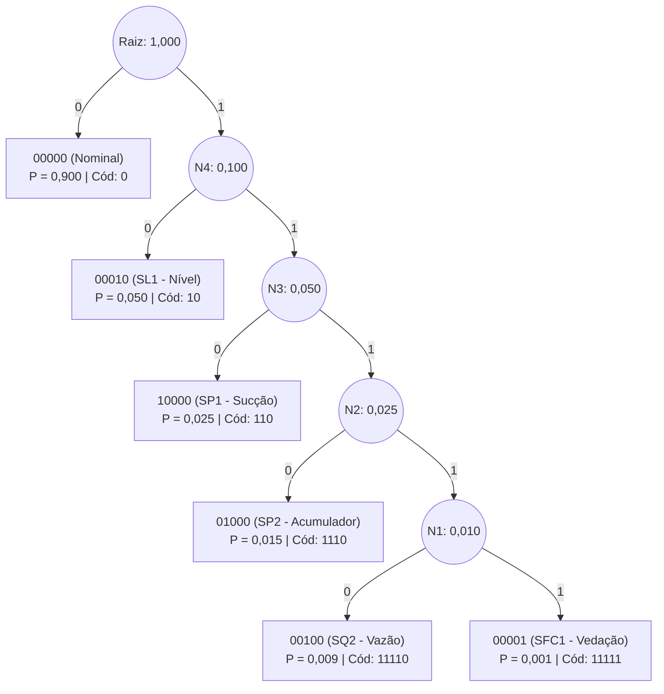

# Compressão de Telemetria via Algoritmo de Huffman no SCADA-Core (Linha de Envase de Bebidas)

## 1. Escopo e Arquitetura do Sistema de Transmissão

O sistema **SCADA-Core (Grupo 3 — ECAA08)** gerencia a telemetria contínua da **Linha Automatizada de Envasamento e Inspeção de Bebidas** em tempo real, transmitindo o status operacional dos módulos de suprimento (`TS1`/`BC1`/`AS1`), dosagem (`VS2`), inspeção de nível, tampagem (`AC1`) e vedação sobre a esteira transportadora `RC1` por redes de comunicação industrial como Modbus-RTU, PROFIBUS-DP ou OPC-UA. Em transmissões não comprimidas, o estado lógico da instrumentação de campo padronizada segundo a norma ISA-5.1 é empacotado em palavras binárias de tamanho fixo.

Considerando os 5 sensores primários da malha de intertravamento, controle de qualidade e segurança operacional da linha de envase — `SP1` (Pressão de Sucção), `SP2` (Pressão do Acumulador `AS1`), `SQ2` (Vazão de Dosagem/Envase), `SL1` (Sensor Óptico de Nível $\ge 95\%$) e `SFC1` (Sensor Fim de Curso de Vedação/Tampa) —, o formato fixo exige 5 bits por *frame* de telemetria.

Com altas taxas de varredura (*scan rates* de $10\text{ ms}$ a $50\text{ ms}$) sincronizadas ao movimento indexado da esteira `RC1` ($0,1$ a $0,4\text{ m/s}$) em links de telemetria serial com largura de banda restrita (ex.: $9600\text{ bps}$), o envio constante de quadros redundantes causa saturação do barramento. Como a linha de envasamento opera em regime nominal estável durante a maior parte do turno produtivo, a aplicação da codificação de Huffman realiza a compressão sem perdas (*lossless*) dos dados no CLP antes do envio no barramento físico.

## 2. Modelo Probabilístico e Algoritmo de Huffman

O alfabeto discreto de mensagens $S = \{s_1, s_2, \dots, s_6\}$ representa as combinações do vetor binário de estados de alarme/evento `[SP1, SP2, SQ2, SL1, SFC1]`.

### Matriz de Probabilidades Operacionais na Linha de Envase

| Código do Estado | Instrumentos em Nível Lógico 1 | Condição Operacional na Linha de Envase | Probabilidade $P(s_i)$ |
| --- | --- | --- | --- |
| `00000` | Nenhum | Operação Nominal Estável de Envase e Tampagem | $0,900$ ($90,0\%$) |
| `00010` | `SL1` | Alarme de Nível Insuficiente na Garrafa ($< 95\%$ em `VS3`/`SL1`) | $0,050$ ($5,0\%$) |
| `10000` | `SP1` | Alarme de Pressão na Sucção de `TS1`/`BC1` ($< 1,0$ ou $> 3,5\text{ Barg}$) | $0,025$ ($2,5\%$) |
| `01000` | `SP2` | Alarme de Sobrepressão no Acumulador `AS1` ($> 4,5\text{ Barg}$) | $0,015$ ($1,5\%$) |
| `00100` | `SQ2` | Desvio de Vazão Volumétrica no Dosador `VS2` ($< 2,0$ ou $> 8,0\text{ L/min}$) | $0,009$ ($0,9\%$) |
| `00001` | `SFC1` | Falha Crítica de Vedação (Tampa Ausente em `VS5`/`SFC1` — Parada/Rejeito) | $0,001$ ($0,1\%$) |

### Construção da Árvore de Huffman

1. **Combinação 1:** Os dois símbolos de menor probabilidade, `00100` (`SQ2`: $0,009$) e `00001` (`SFC1`: $0,001$), são unidos no nó intermediário $N_1$ com peso $0,010$.
2. **Combinação 2:** Une-se $N_1$ ($0,010$) ao símbolo `01000` (`SP2`: $0,015$), resultando no nó $N_2$ com peso $0,025$.
3. **Combinação 3:** Une-se $N_2$ ($0,025$) ao símbolo `10000` (`SP1`: $0,025$), gerando o nó $N_3$ com peso $0,050$.
4. **Combinação 4:** Une-se $N_3$ ($0,050$) ao símbolo `00010` (`SL1`: $0,050$), gerando o nó $N_4$ com peso $0,100$.
5. **Combinação 5:** Une-se $N_4$ ($0,100$) ao símbolo de maior frequência `00000` (Operação Nominal: $0,900$), formando a raiz da árvore binária com peso $1,000$.

Atribuindo o bit `0` às ramificações de maior probabilidade e `1` às de menor probabilidade, obtém-se o dicionário de códigos prefixados ótimos:

| Estado Original (Fixos: 5 bits) | Símbolo / Evento Associado | Código de Huffman | Comprimento $l(s_i)$ |
| --- | --- | --- | --- |
| `00000` | Regime Nominal (`RC1`, `BC1`, `VS1`–`VS5` OK) | `0` | 1 bit |
| `00010` | Rejeição por Nível Baixo (`SL1`) | `10` | 2 bits |
| `10000` | Anomalia de Pressão na Sucção (`SP1`) | `110` | 3 bits |
| `01000` | Alívio de Sobrepressão no Pulmão (`SP2`) | `1110` | 4 bits |
| `00100` | Anomalia de Vazão de Enchimento (`SQ2`) | `11110` | 5 bits |
| `00001` | Falha de Selagem / Tampa Ausente (`SFC1`) | `11111` | 5 bits |



### Avaliação de Desempenho e Economia de Banda

* **Entropia Teórica de Shannon ($H(S)$):**

$$H(S) = -\sum_{i=1}^{6} P(s_i) \log_2 P(s_i) \approx 0,6480 \text{ bits/símbolo}$$


* **Comprimento Médio da Palavra-Código ($L$):**

$$L = \sum_{i=1}^{6} P(s_i) \cdot l(s_i) = (0,90 \cdot 1) + (0,05 \cdot 2) + (0,025 \cdot 3) + (0,015 \cdot 4) + (0,009 \cdot 5) + (0,001 \cdot 5) = 1,1850 \text{ bits/símbolo}$$


* **Taxa de Economia de Banda (Compressão):**

$$\text{Redução de Banda} = \left( 1 - \frac{L}{L_{\text{fixo}}} \right) \times 100\% = \left( 1 - \frac{1,1850}{5} \right) \times 100\% = 76,30\%$$


## 3. Protocolo de Enquadramento e Integração CLP/SCADA

### Estrutura do Pacote de Transmissão em Campo

Para transmissão via rede serial RS-485 (Modbus-RTU) ou soquete TCP/IP entre o CLP da linha de envase e o servidor supervisório sem perda de sincronismo de bit, os dados comprimidos são encapsulados no seguinte formato de quadro:

```
+------------------+-------------------+--------------------+--------------------+
| Header (8 bits)  | Length (8 bits)   | Huffman Payload    | CRC-16 (16 bits)   |
| 0xA5 (Start Byte)| Tamanho do Payload| Bits Codificados   | Verificação Erro   |
+------------------+-------------------+--------------------+--------------------+

```

### Algoritmo de Processamento no CLP e Servidor

* **Codificação no Controlador Lógico Programável (CLP):** A cada ciclo de varredura (*scan cycle*) da esteira `RC1`, o CLP lê os sinais discretizados dos sensores `[SP1, SP2, SQ2, SL1, SFC1]`, mapeia o vetor de 5 bits, realiza a busca em $\mathcal{O}(1)$ na tabela hash do dicionário de Huffman e insere os bits correspondentes no buffer circular de saída.


* **Decodificação Determinística no Servidor SCADA-Core:** O servidor executa a leitura do fluxo binário navegando pela árvore de Huffman armazenada em memória RAM. Por se tratar de um código estritamente prefixado (nenhum código é prefixo de outro), a decodificação é determinística e instantânea com complexidade $\mathcal{O}(k)$, onde $k$ é a quantidade de bits do código transmitido (máximo de 5 iterações por mensagem).
* **Integridade e Redundância SIS (IEC 61508 / SIL-2):** Se o código recebido for desalinhado por ruído eletromagnético dos inversores de frequência da esteira `RC1` ou da bomba `BC1` e não corresponder a uma folha válida da árvore, a rotina de validação aciona a falha de checagem CRC-16, descarta o quadro corrompido, fecha preventivamente as válvulas solenoides `VS1`/`VS2` e mantém a indicação de diagnóstico na IHM do operador.
