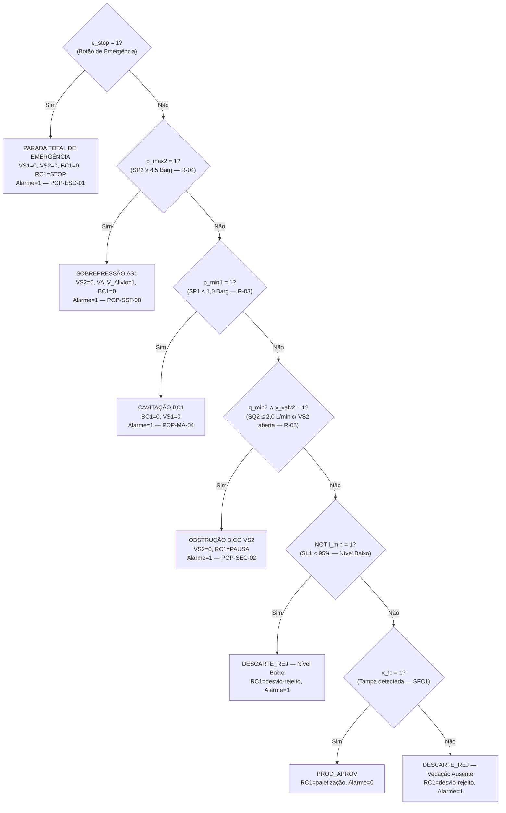

# Árvores Binárias no SCADA-Core de Engarrafamento e Inspeção de Bebidas

### Informações do Projeto

| Parâmetro | Detalhe |
| ----- | ----- |
| **Unidade Industrial** | Linha Automatizada de Envase e Inspeção de Bebidas (Módulos 1 a 6 — Grupo 3) |
| **Aplicação** | Árvore Binária de Decisão (BDT) para SIS de Intertravamento e Controle de Qualidade; Árvore AVL para Indexação Temporal do Historiador SCADA-Core |
| **Estruturas de Dados** | Árvores Binárias de Decisão (BDT) e Árvores Binárias de Busca Auto-Balanceadas (AVL) |
| **Código do Projeto** | ECAA08-SISTEMA-SCADA-GRUPO3 |

---

## 1. Árvore Binária de Decisão (BDT) — Sistema Instrumentado de Segurança e Controle de Qualidade

### 1.1 Contextualização

Na **Linha Automatizada de Envase e Inspeção de Bebidas (SCADA-Core — Grupo 3)**, a correta sequência de verificação de condições de segurança e qualidade é determinante para o funcionamento seguro da planta. A cada ciclo de varredura do CLP (10 a 50 ms), seis condições críticas devem ser avaliadas em ordem de gravidade — das falhas de segurança operacional às de controle de qualidade do produto — antes que a garrafa seja encaminhada para aprovação (`PROD_APROV`) ou descarte (`DESCARTE_REJ`).

A avaliação sequencial e determinística dessas condições é realizada por uma **Árvore Binária de Decisão (BDT)**, estrutura de dados que garante tempo de resposta de pior caso proporcional à sua altura, independentemente do número de entradas.

> [!IMPORTANT]
> Em Sistemas Instrumentados de Segurança (SIS) conforme IEC 61508/61511, o tempo de resposta entre a detecção de uma condição de alarme e a atuação do elemento final deve ser determinístico e delimitado. A BDT oferece exatamente essa garantia: com altura fixa $h = 5$, o pior caso é $O(h) = O(1)$ em termos assintóticos.

### 1.2 Formalização Matemática

Define-se a árvore de decisão como um grafo acíclico orientado $T = (V, E)$, onde:

$$T = (V, E), \quad V = V_{\text{interno}} \cup V_{\text{folha}}$$

- $V_{\text{interno}}$: conjunto de nós de decisão, cada um associado a um **predicado booleano** derivado da instrumentação ISA-5.1 da linha de envase.
- $V_{\text{folha}}$: conjunto de nós terminais, cada um contendo a **ação de atuação** (configuração de válvulas, bomba, esteira e alarme) e a **disposição do produto** (aprovação ou rejeição).
- $E$: conjunto de arestas direcionadas, representando as transições de decisão $\{1 = \text{Verdadeiro},\; 0 = \text{Falso}\}$.

A avaliação percorre a árvore em **curto-circuito** (*short-circuit evaluation*): a partir da raiz, a cada nó interno, avalia-se o predicado e segue-se o ramo correspondente, sem avaliar ramos não alcançados. Isso garante a invariante de que o predicado mais crítico — `e_stop` — é sempre verificado primeiro.

A **ordenação dos nós internos** obedece à seguinte hierarquia de gravidade de risco, extraída diretamente do catálogo de regras R-01..R-10 (Aula 10):

| Nível $h$ | Predicado | Criticidade | Regra Referenciada |
| :---: | :--- | :--- | :--- |
| 0 (Raiz) | `e_stop` | Parada de emergência — máxima prioridade | R-09 |
| 1 | `p_max2` (SP2 ≥ 4,5 Barg) | Sobrepressão no acumulador AS1 | R-04 |
| 2 | `p_min1` (SP1 ≤ 1,0 Barg) | Risco de cavitação na bomba BC1 | R-03 |
| 3 | `q_min2` ∧ `y_valv2` | Obstrução no bico de envase VS2 | R-05 |
| 4 | `¬l_min` (SL1 < 95%) | Nível de preenchimento insuficiente (qualidade) | — |
| 5 (Folha) | `x_fc` (SFC1 = 1) | Tampa detectada (qualidade) → aprovação ou rejeição | — |

> [!NOTE]
> **Convenção `l_min`:** `l_min = True` quando SL1 ≥ 95% (nível **conforme** / aprovado). O alarme de nível insuficiente é representado por `¬l_min` (nível < 95%). Essa semântica é a adotada na tabela 3.1 da Aula 10 do grupo.

### 1.3 Topologia da Árvore — Diagrama Mermaid



### 1.4 Tabela de Estados da BDT — Mapeamento ISA-5.1

A tabela abaixo especifica cada nó interno, a condição booleana avaliada, a atuação sobre os elementos finais e o estado funcional resultante:

| Nível ($h$) | Nó de Decisão | Tag ISA-5.1 | Condição Lógica | Atuação sobre Atuadores | Estado Funcional |
| :---: | :---: | :---: | :---: | :--- | :--- |
| **0 (Raiz)** | `e_stop` | Botão de Emergência | $e_{\text{stop}} = 1 \implies \text{Pressionado}$ | VS1=0, VS2=0, BC1=0, RC1=STOP, Alarme=1 | Parada Total de Emergência |
| **1** | `p_max2` | SP2 — Pressão do Acumulador AS1 | $p_{\text{max2}} = 1 \implies \text{SP2} \ge 4{,}5\text{ Barg}$ | VS2=0, VALV_Alivio=1, BC1=0, Alarme=1 | Trip por Sobrepressão no AS1 |
| **2** | `p_min1` | SP1 — Pressão de Sucção | $p_{\text{min1}} = 1 \implies \text{SP1} \le 1{,}0\text{ Barg}$ | BC1=0, VS1=0, Alarme=1 | Trip por Risco de Cavitação BC1 |
| **3** | `q_min2` ∧ `y_valv2` | SQ2/VS2 — Vazão e Válvula de Envase | $q_{\text{min2}} \land y_{\text{valv2}} = 1 \implies \text{SQ2} \le 2{,}0\text{ L/min c/ VS2 aberta}$ | VS2=0, RC1=PAUSA, Alarme=1 | Obstrução no Bico de Envase |
| **4** | `¬l_min` | SL1 — Sensor de Nível | $\neg l_{\text{min}} = 1 \implies \text{SL1} < 95\%$ | RC1=desvio-rejeito, Alarme=1 | Rejeição por Nível Insuficiente |
| **5a (Folha)** | `x_fc` | SFC1 — Sensor de Fim de Curso | $x_{\text{fc}} = 1 \implies \text{Tampa detectada}$ | RC1=paletização, Alarme=0 | **PROD_APROV** |
| **5b (Folha)** | `¬x_fc` | SFC1 — Sensor de Fim de Curso | $x_{\text{fc}} = 0 \implies \text{Tampa ausente}$ | RC1=desvio-rejeito, Alarme=1 | **DESCARTE_REJ** (vedação) |

### 1.5 Análise de Complexidade Computacional e Tempo Real

**Determinismo temporal:** a árvore possui altura fixa $h = 5$, portanto o número de predicados avaliados em qualquer cenário de operação é no máximo $h + 1 = 6$. O tempo de varredura de pior caso no CLP é delimitado por:

$$O(h) = O(5) = O(1) \quad \text{(tempo constante em relação ao número de variáveis)}$$

**Relação com o ciclo de varredura da linha de envase:**

$$t_{\text{resposta}} = t_{\text{detecção}} + t_{\text{BDT}} + t_{\text{atuação solenoide}}$$

Com scan de 10 a 50 ms, decisão BDT ≪ 1 ms (conforme benchmark da Aula 15: ~0,05 ms para o motor de grafos; a BDT é ainda mais rápida), e tempo de atuação de solenoide ~120 ms:

$$t_{\text{resposta}} \approx 50\text{ ms} + 0{,}05\text{ ms} + 120\text{ ms} \approx 170\text{ ms}$$

A BDT é o componente mais rápido da cadeia de segurança, confirmando sua adequação a sistemas de intertravamento conforme IEC 61508/61511.

---

## 2. Árvore Binária de Busca Auto-Balanceada (AVL) — Indexador Temporal do Historiador SCADA-Core

### 2.1 Contextualização

O **Historiador de Processos (Process Historian)** do SCADA-Core registra continuamente a telemetria de todos os instrumentos da linha de envase — `SP1`, `SQ1`, `SP2`, `SQ2`, `SL1` e `SFC1` — a taxas de varredura de 10 a 50 ms. Para viabilizar:

1. **Análise de falhas pós-incidente** (*Root Cause Analysis* — RCA) com rastreabilidade completa das condições de cada garrafa;
2. **Gráficos de tendência em tempo real** na IHM do operador, cobrindo janelas de até 30 minutos;
3. **Consultas por intervalo temporal** (ex.: "quais garrafas foram envasadas entre 14h00 e 14h15?"),

os dados de telemetria são indexados em memória principal utilizando uma **Árvore AVL (Adelson-Velsky e Landis)**, que garante operações de inserção e busca em $O(\log N)$ mesmo sob inserções contínuas de alta frequência.

### 2.2 Estrutura do Nó na Memória

Cada nó $N$ na árvore AVL armazena o *timestamp* UNIX ($\tau$ em milissegundos) como chave primária de ordenação e o vetor de telemetria da linha de envase como carga útil (*payload*):

$$N = \Big\langle \tau, \; BF, \; \text{Ponteiro}_{\text{Esq}}, \; \text{Ponteiro}_{\text{Dir}}, \; \mathbf{D}(\tau) \Big\rangle$$

Onde o vetor de estado telemetrado contém os seis sinais primários do SCADA-Core:

$$
\mathbf{D}(\tau) =
\begin{bmatrix}
\underbrace{P_{\text{SP1}}}_{\text{Barg}},
\underbrace{Q_{\text{SQ1}}}_{\text{L/min}},
\underbrace{P_{\text{SP2}}}_{\text{Barg}},
\underbrace{Q_{\text{SQ2}}}_{\text{L/min}},
\underbrace{L_{\text{SL1}}}_{\text{\%}},
\underbrace{X_{\text{SFC1}}}_{\{0,1\}}
\end{bmatrix}
$$

### 2.3 Propriedade de Balanceamento AVL e Fator de Balanceamento ($BF$)

Para qualquer nó $n \in V$, o **Fator de Balanceamento** $BF(n)$ é rigorosamente mantido pela invariante AVL:

$$BF(n) = h(T_{\text{direita}}) - h(T_{\text{esquerda}}) \in \{-1, \; 0, \; +1\}$$

Se após uma inserção de telemetria o valor $|BF(n)| > 1$, executa-se o rebalanceamento em tempo $O(1)$ através de **rotações binárias**:

| Rotação | Condição de Ativação | Operação |
| :--- | :--- | :--- |
| **LL** (Simples à Direita) | $BF(n) = -2$ e $BF(n.\text{esq}) \le 0$ | Pivô no filho esquerdo |
| **RR** (Simples à Esquerda) | $BF(n) = +2$ e $BF(n.\text{dir}) \ge 0$ | Pivô no filho direito |
| **LR** (Dupla Esq-Dir) | $BF(n) = -2$ e $BF(n.\text{esq}) > 0$ | RR no filho esq., depois LL no nó |
| **RL** (Dupla Dir-Esq) | $BF(n) = +2$ e $BF(n.\text{dir}) < 0$ | LL no filho dir., depois RR no nó |

### 2.4 Topologia — Exemplo com Timestamps da Esteira RC1

Considerando amostragem a 20 Hz (50 ms entre leituras), com início da janela às 14h00:00,000 (1772450000000 ms):

```
                       [τ = 1772450000100 ms]  (BF =  0)
                              /          \
                             /            \
      [τ = 1772450000050 ms]             [τ = 1772450000200 ms]
            (BF = 0)                            (BF = +1)
                                                       \
                                              [τ = 1772450000250 ms]
                                                    (BF = 0)
```

*Percurso em ordem (in-order)* retorna os timestamps em sequência cronológica estrita: $[\tau_1, \tau_2, \tau_3, \tau_4]$ — garantindo extração ordenada para gráficos de tendência.

### 2.5 Algoritmo de Percurso e Complexidade Computacional

**Percurso em Ordem** (*In-Order Traversal*) para recuperação cronológica:

$$\text{Percurso}(n) = \text{Percurso}(n.\text{esq}) \;\longrightarrow\; \text{Processa}\!\left(\mathbf{D}(n.\tau)\right) \;\longrightarrow\; \text{Percurso}(n.\text{dir})$$

Como a AVL mantém $\tau$ estritamente ordenado, este percurso garante extração cronológica com complexidade linear adicional $O(K)$, onde $K$ é o número de registros no intervalo consultado.

| Operação de Processo | Complexidade Média | Pior Caso (Garantido) |
| :--- | :---: | :---: |
| Inserção de amostra telemetrada | $O(\log_2 N)$ | $O(\log_2 N)$ |
| Consulta pontual por timestamp (RCA) | $O(\log_2 N)$ | $O(\log_2 N)$ |
| Consulta por intervalo $[t_{\text{ini}}, t_{\text{fim}}]$ | $O(\log_2 N + K)$ | $O(\log_2 N + K)$ |
| Verificação de BF em todos os nós | $O(N)$ | $O(N)$ |

*$N$ = total de amostras indexadas em memória; $K$ = registros retornados no intervalo.*

> [!TIP]
> Para uma janela de 30 minutos com scan de 50 ms, $N = 30 \times 60 \times 20 = 36.000$ amostras. Com a AVL, uma consulta por intervalo de 1 minuto (1.200 registros) custa $O(\log_2 36.000 + 1.200) \approx O(15 + 1.200)$ operações — frente a $O(36.000)$ de uma busca linear. Para lote de 8 horas ($N \approx 576.000$), a vantagem é ainda mais pronunciada.

---

## 3. Síntese Comparativa — BDT × AVL na Linha de Envase

| Propriedade de Engenharia | Árvore Binária de Decisão (SIS + QC) | Árvore Binária AVL (Historiador) |
| :--- | :--- | :--- |
| **Objetivo Industrial** | Intertravamento de Segurança e Classificação de Produto | Armazenamento e Consulta Temporal de Telemetria |
| **Elemento Chave de Ordenação** | Gravidade de Risco (manual, invariável) | Timestamp UNIX ($\tau$) em milissegundos |
| **Modificação da Estrutura** | **Estática** (definida em projeto de automação) | **Dinâmica** (inserções a cada 10–50 ms) |
| **Critério de Desempenho** | Resposta delimitada $O(h) = O(1)$ | Consultas em séries temporais $O(\log_2 N)$ |
| **Tags Envolvidas** | `e_stop`, `SP2`, `SP1`, `SQ2`, `SL1`, `SFC1` | `SP1`, `SQ1`, `SP2`, `SQ2`, `SL1`, `SFC1` |
| **Resultado de Negócio** | `PROD_APROV` / `DESCARTE_REJ` / Trip de Segurança | Gráfico de Tendência IHM / Relatório RCA |
| **Referência Normativa** | IEC 61508 / IEC 61511 | Auditoria de Processo e Rastreabilidade de Batelada |


---

## 4. Referências

1. CORMEN, T. H. et al. **Algoritmos: Teoria e Prática**. 3. ed. Rio de Janeiro: Elsevier, 2012.
2. ADELSON-VELSKY, G.; LANDIS, E. **An Algorithm for the Organization of Information**. Soviet Mathematics — Doklady, v. 3, p. 1259–1263, 1962.
3. ISA — INTERNATIONAL SOCIETY OF AUTOMATION. **ANSI/ISA-5.1: Instrumentation Symbols and Identification**. Research Triangle Park, NC, 2009.
4. IEC. **IEC 61511: Functional Safety — Safety Instrumented Systems for the Process Industry Sector**. Geneva: IEC, 2016.
5. Grupo 3 — ECAA08. **Aula 10: Motor de Intertravamento e Diagnóstico**. UNIFEI, 2026.
