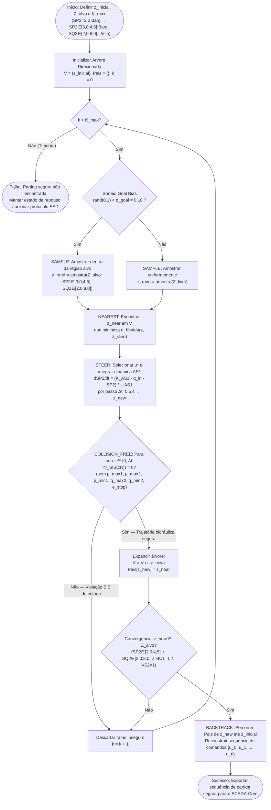

# Rapidly-exploring Random Trees (RRT) no SCADA-Core de Engarrafamento e Inspeção de Bebidas

### Informações do Projeto

| Parâmetro | Detalhe |
| ----- | ----- |
| **Unidade Industrial** | Linha Automatizada de Envase e Inspeção de Bebidas (Módulos 1 a 6 — Grupo 3) |
| **Aplicação** | Planejamento de Trajetória Cinodinâmica para Partida Segura da Linha: Pressurização do Acumulador AS1 com Desvio de Regiões Proibidas pelo SIS |
| **Método Formulado** | *Rapidly-exploring Random Trees* (RRT) com Espaço de Estados Híbrido e Verificação Booleana Φ_SIS |
| **Código do Projeto** | ECAA08-SISTEMA-SCADA-GRUPO3 |

---

## 1. Analogia Intuitiva — O RRT como Raiz Buscando Pressão Segura

Imagine a linha de envase no instante da partida matinal: o acumulador AS1 está com pressão abaixo de 3,0 Barg, as válvulas solenoides VS1 e VS2 estão fechadas, e a bomba centrífuga BC1 ainda está parada. O objetivo é chegar ao estado operacional pleno — AS1 pressurizado entre 3,0 e 4,5 Barg, com VS2 aberta e SQ2 estável entre 2,0 e 8,0 L/min — **sem passar por nenhuma região proibida**: sem cavitar a BC1 (SP1 ≤ 1,0 Barg), sem sobrepressionar o AS1 (SP2 ≥ 4,5 Barg), sem obstruir o bico VS2 (SQ2 ≤ 2,0 L/min com VS2 aberta), sem exceder SP1 (SP1 ≥ 3,5 Barg) e sem emergências ativas.

O algoritmo **RRT (Rapidly-exploring Random Tree)** resolve esse planejamento da seguinte forma:

* **Árvore (*Tree*):** O algoritmo começa no estado de repouso da linha (o "tronco") e cria ramificações de estados sucessivos — cada ramo é uma trajetória fisicamente realizável pelo sistema hidráulico.
* **Aleatório (*Random*):** Em vez de calcular exaustivamente todas as trajetórias possíveis no espaço de pressão, vazão e estado dos atuadores, o algoritmo sorteia pontos aleatórios nesse espaço para decidir em qual direção expandir.
* **Exploração Rápida (*Rapidly-exploring*):** Como os pontos sorteados tendem a cair em regiões ainda não alcançadas pelos ramos existentes, a árvore avança rapidamente para novas regiões do espaço de operação — evitando o desperdício computacional de redescobrir estados já conhecidos.

**Passo a passo:**

1. **Ponto de partida:** estado de repouso da linha (AS1 com SP2 = 2,0 Barg, BC1 desligada).
2. **Sorteio de direção:** um ponto aleatório no espaço de operação é amostrado (de vez em quando, sorteia-se diretamente o estado alvo — pressão e vazão nominais de envase).
3. **Ramo mais próximo:** identifica-se qual ponta da árvore já existente está mais perto do ponto sorteado.
4. **Passo dinâmico:** a partir dessa ponta, aplica-se um controle (abrir VS1, ligar BC1, ajustar VS2) e integra-se a dinâmica hidráulica do acumulador por um intervalo $\Delta t$.
5. **Verificação do SIS:** ao longo de todo o passo, verifica-se se $\Phi_{\text{SIS}}(\mathbf{z}(\tau)) = 0$ para todo $\tau \in [0, \Delta t]$. Se alguma condição de alarme for violada, o ramo é descartado.
6. **Repetição:** o processo se repete até que um ramo alcance a janela operacional de envase (estado alvo).
7. **Retrocesso (*Backtrack*):** uma vez atingido o objetivo, percorre-se a árvore de volta à raiz para extrair a sequência de comandos de controle — a "receita de partida segura" a ser executada pelo SCADA.

---

## 2. Formalização Teórica no Contexto da Linha de Envase

Diferente de métodos baseados em grades discretas fixas (como $A^*$ ou programação dinâmica clássica), cuja complexidade cresce exponencialmente com a dimensão do sistema ($O(k^d)$, a "maldição da dimensionalidade"), o RRT explora o espaço de estados **aplicando diretamente as equações diferenciais do processo hidráulico**. Isso garante que cada aresta gerada na árvore seja fisicamente realizável pelos atuadores da planta (válvulas solenoides e bomba centrífuga).

### 2.1 Espaço de Estados Híbrido ($\mathcal{Z} = \mathcal{X} \times \mathcal{Q}$)

O estado instantâneo da linha de envase pertence ao espaço **híbrido** $\mathcal{Z}$, composto por:

* **Subespaço Contínuo** ($\mathcal{X} \subset \mathbb{R}^4$): reúne as variáveis instrumentadas que descrevem a condição hidráulica da linha:

$$\mathbf{x} = \begin{bmatrix} P_{\text{SP2}} \\ Q_{\text{SQ2}} \\ P_{\text{SP1}} \\ Q_{\text{SQ1}} \end{bmatrix} \in \mathbb{R}^4 \quad \text{[Barg, L/min, Barg, L/min]}$$

* **Subespaço Discreto** ($\mathcal{Q} \subset \{0,1\}^5$): representa a configuração lógica dos cinco atuadores principais da linha:

$$
\mathbf{q} =
\left(
q_{\text{VS1}},
q_{\text{BC1}},
q_{\text{VS2}},
q_{\text{RC1}},
q_{\mathrm{VALV\_Alivio}}
\right)
\in \{0,1\}^{5}
$$

O estado híbrido completo é o par $\mathbf{z} = (\mathbf{x}, \mathbf{q}) \in \mathcal{Z}$.

### 2.2 Espaço de Obstáculos ($\mathcal{Z}_{\text{obs}}$) via Barreira Booleana $\Phi_{\text{SIS}}$

Em robótica móvel, obstáculos são paredes físicas. Na linha de envase, os obstáculos são **fronteiras hidráulicas e de segurança funcional** definidas pelas proposições booleanas do catálogo R-01..R-10 (Aula 10) e pelos limiares da norma ISA-5.1:

$$
\mathcal{Z}_{\text{obs}} =
\{
\mathbf{z} \in \mathcal{Z}
\mid
\Phi_{\mathrm{SIS\_envase}}(\mathbf{z}) = 1
\}
$$

Onde a barreira booleana do SIS é definida como a disjunção lógica de todos os predicados de alarme crítico:

$$
\begin{aligned}
\Phi_{\mathrm{SIS\_envase}}(\mathbf{z}) =\;&
\underbrace{p_{\mathrm{max1}}}_{\text{SP1} \ge 3{,}5\text{ Barg}}
\lor
\underbrace{p_{\mathrm{max2}}}_{\text{SP2} \ge 4{,}5\text{ Barg}}
\\
&\lor
\underbrace{p_{\mathrm{min1}}}_{\text{SP1} \le 1{,}0\text{ Barg} \land q_{\mathrm{BC1}}=1}
\\
&\lor
\underbrace{q_{\mathrm{max2}}}_{\text{SQ2} \ge 8{,}0\text{ L/min} \land q_{\mathrm{VS2}}=1}
\\
&\lor
\underbrace{q_{\mathrm{min2}}}_{\text{SQ2} \le 2{,}0\text{ L/min} \land q_{\mathrm{VS2}}=1 \land q_{\mathrm{BC1}}=1}
\\
&\lor
\underbrace{e_{\mathrm{stop}}}_{\text{emergência}}
\end{aligned}
$$

O RRT busca uma trajetória inteiramente contida em $\mathcal{Z}_{\mathrm{livre}} = \mathcal{Z} \setminus \mathcal{Z}_{\mathrm{obs}}$.

### 2.3 Propriedade do Viés de Voronoi (*Voronoi Bias*)

A eficiência exploratória do RRT decorre da partição de Voronoi induzida pelos vértices $V$ já existentes na árvore. A probabilidade de um vértice $\mathbf{z}_{\text{near}} \in V$ ser escolhido para expansão é proporcional ao hipervolume de sua célula de Voronoi $\mathcal{V}(\mathbf{z}_{\text{near}})$:

$$P(\text{expansão em } \mathbf{z}_{\text{near}}) \propto \text{vol}\!\left(\mathcal{V}(\mathbf{z}_{\text{near}})\right)$$

Como os vértices na fronteira da árvore (ainda não explorados) possuem células de Voronoi muito maiores voltadas para regiões do espaço de operação hidráulica ainda não visitadas, a amostragem uniforme $\mathbf{z}_{\text{rand}} \sim \mathcal{U}(\mathcal{Z})$ naturalmente "puxa" a árvore em direção às zonas não exploradas — sem necessidade de uma função de custo global explícita.

### 2.4 Direção Cinodinâmica (*Kinodynamic Steering*)

Em um sistema hidráulico com inércia do acumulador AS1, não é possível impor uma "linha reta" arbitrária entre dois estados no espaço $\mathcal{X}$. A partir do vértice mais próximo $\mathbf{z}_{\text{near}}$, o algoritmo:

1. Seleciona uma ação de controle admissível $\mathbf{u} \in \mathcal{U}_{\text{adm}}$ (vazão alvo de entrada $q_{\text{in}}$ e de saída $q_{\text{out}}$, e configuração dos atuadores discretos $\mathbf{q}$);
2. Integra a dinâmica de **1ª ordem do acumulador AS1** por um intervalo $\Delta t$, gerando o novo vértice $\mathbf{z}_{\text{new}}$:

$$\dot{P}_{\text{SP2}} = \frac{K_{\text{AS1}} \cdot q_{\text{in}} - P_{\text{SP2}}}{\tau_{\text{AS1}}} \quad \text{[PREMISSA P-01, P-02]}$$

$$P_{\text{SP2}}(t + \Delta t) = P_{\text{SP2}}(t) + \Delta t \cdot \dot{P}_{\text{SP2}}$$

> [!NOTE]
> **Premissas do modelo dinâmico:**  
> **[PREMISSA P-01]:** $\tau_{\text{AS1}} = 10\text{ s}$ — constante de tempo do acumulador AS1. Estimada como valor central para acumuladores hidráulicos de pequeno porte em linhas de envase (faixa típica: 5–15 s). Deve ser calibrada com ensaios reais na linha.  
> **[PREMISSA P-02]:** $K_{\text{AS1}} = 0{,}3\text{ Barg/(L/min)}$ — ganho hidráulico. Representa a proporcionalidade entre variação de vazão de entrada e variação de pressão em regime estacionário.  
> **[PREMISSA P-03]:** $\Delta t = 0{,}5\text{ s}$ — passo de integração, compatível com 10× o scan máximo (50 ms).

---

## 3. Fluxograma do Algoritmo RRT na Linha de Envase

---

## 4. Correspondência entre Primitivas do RRT e a Engenharia da Linha de Envase

| Primitiva Algorítmica | Fundamento em Matemática Discreta / Controle | Papel Físico na Linha de Envase |
| :--- | :--- | :--- |
| **`SAMPLE`** (com *Goal Bias*) | Amostragem estocástica em espaço métrico híbrido com distribuição mista $(1 - p_{\text{goal}})\mathcal{U}(\mathcal{Z}) + p_{\text{goal}}\mathcal{U}(\mathcal{Z}_{\text{alvo}})$, $p_{\text{goal}} = 0{,}10$ **[PREMISSA P-05]** | Equilibra a exploração global das condições hidráulicas possíveis (pressões e vazões) com a convergência direcionada para a janela operacional de envase (SP2∈[3,0;4,5] Barg, SQ2∈[2,0;8,0] L/min). |
| **`NEAREST`** | Busca do vizinho mais próximo em $V$ sob métrica híbrida ponderada: $d(\mathbf{z}_a, \mathbf{z}_b) = \|\mathbf{x}_a - \mathbf{x}_b\|_{\mathbf{W}} + \lambda \cdot d_H(\mathbf{q}_a, \mathbf{q}_b)$ | Pondera grandezas físicas heterogêneas (Barg e L/min) e penaliza comutações desnecessárias de válvulas solenoides (`VS1`–`VS5`) e da bomba `BC1` (distância de Hamming $d_H$), reduzindo desgaste de atuadores. |
| **`STEER`** | Problema de controle ótimo local de horizonte curto ($\Delta t$) sujeito à dinâmica: $\dot{\mathbf{x}} = f(\mathbf{x}, \mathbf{q}, \mathbf{u})$ — modelo de 1ª ordem do AS1 **[PREMISSAS P-01, P-02, P-03]** | Calcula a sequência de abertura de `VS1`, acionamento de `BC1` e abertura de `VS2` que pressuriza o acumulador `AS1` em direção ao estado alvo, respeitando os limites físicos dos atuadores e a janela de pressão. |
| **`COLLISION_FREE`** | Verificação de invariância de conjunto: $\mathbf{z}(\tau) \in \mathcal{Z}_{\text{livre}}, \;\forall \tau \in [0, \Delta t]$ — integração em substeps e avaliação de $\Phi_{\text{SIS}}$ em cada ponto | Garante que, mesmo durante o transitório de pressurização do `AS1`, nenhum predicado de alarme seja violado: sem cavitação em `BC1` (`p_min1`), sem sobrepressão em `AS1` (`p_max2`), sem obstrução no bico `VS2` (`q_min2`). |
| **`BACKTRACK`** | Travessia reversa única em árvore enraizada (grau de entrada = 1 para todo $v \neq \mathbf{z}_{\text{inicial}}$) | Extrai a sequência determinística de comandos de controle `{u_0, u_1, ..., u_n}` — a "receita de partida segura" a ser executada em malha fechada pelo SCADA-Core, com referência de SP2 e SQ2 para os controladores PID da linha. |

---

## 5. Referências

1. LAVALLE, S. M. **Planning Algorithms**. Cambridge: Cambridge University Press, 2006. Disponível em: <http://lavalle.pl/planning/>.
2. CORMEN, T. H. et al. **Algoritmos: Teoria e Prática**. 3. ed. Rio de Janeiro: Elsevier, 2012.
3. ISA — INTERNATIONAL SOCIETY OF AUTOMATION. **ANSI/ISA-5.1: Instrumentation Symbols and Identification**. Research Triangle Park, NC, 2009.
4. IEC. **IEC 61511: Functional Safety — Safety Instrumented Systems for the Process Industry Sector**. Geneva: IEC, 2016.
5. Grupo 3 — ECAA08. **Aula 10: Motor de Intertravamento e Diagnóstico; Aula 15: Simulação de Vazamentos e Desvio Automático**. UNIFEI, 2026.

