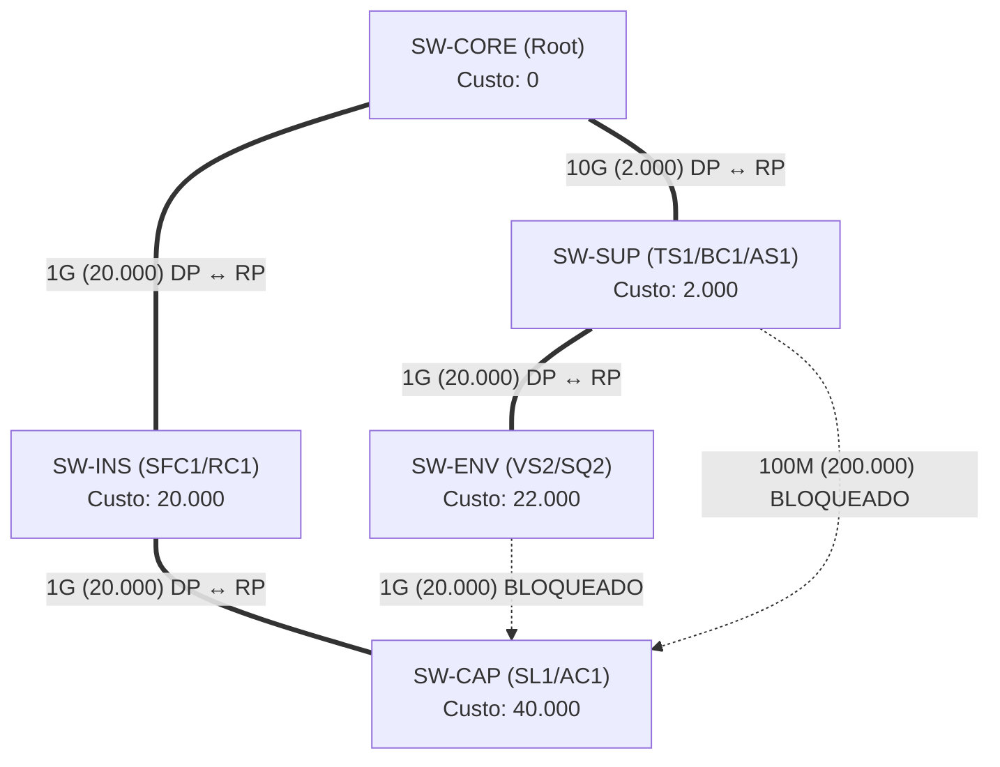
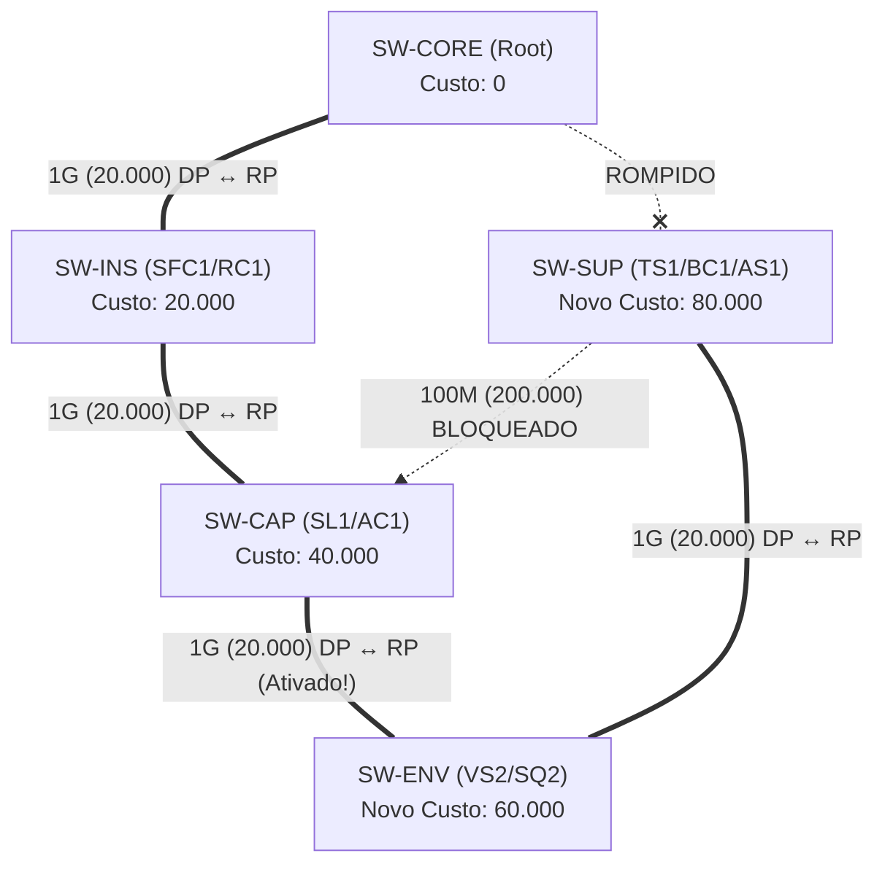

# Protocolo de Árvore Geradora (STP / RSTP) no SCADA-Core da Linha de Envase e Inspeção de Bebidas

### Informações do Projeto

| Parâmetro | Detalhe |
| ----- | ----- |
| **Unidade Industrial** | Linha Automatizada de Envase e Inspeção de Bebidas (Módulos 1 a 6 — Grupo 3) |
| **Aplicação** | Redundância de Rede Ethernet Industrial (Camada 2) e Prevenção de *Loops* no Barramento SCADA-Core |
| **Método Formulado** | *Spanning Tree Protocol* (IEEE 802.1D) e *Rapid Spanning Tree Protocol* (IEEE 802.1w) |
| **Código do Projeto** | ECAA08-SISTEMA-SCADA-GRUPO3 |

---

## 1. Analogia Intuitiva — Por que precisamos de caminhos extras, mas sem dar voltas?

Imagine que você precisa garantir que o operador na **Sala de Controle (`SCADA-Core`)** nunca perca o sinal da bomba `BC1`, do acumulador `AS1` ou da esteira `RC1`. A ideia mais natural é passar **cabos redundantes** formando um anel entre os módulos: se alguém cortar ou esmagar um cabo no chão de fábrica, o sinal simplesmente dá a volta pelo outro lado.

O problema é que, em redes Ethernet (Camada 2), **um anel fechado sem controle trava a rede inteira em segundos**. Pense em um grupo de pessoas em círculo onde cada pessoa é obrigada a repetir em voz alta qualquer recado geral que ouvir: o primeiro aviso dá a volta no círculo, volta para quem começou, é repetido de novo e em instantes ninguém consegue mais conversar.

Na rede industrial, esse fenômeno se chama **Tempestade de *Broadcast* (*Broadcast Storm*)** e causa dois efeitos imediatos:
1. **Saturação de 100% da banda:** Os pacotes de telemetria de `SP1`, `SP2`, `SQ2`, `SL1` e `SFC1` não conseguem chegar ao SCADA-Core.
2. ***MAC Flapping*:** Os switches ficam confusos porque recebem o mesmo endereço de um CLP por duas portas diferentes ao mesmo tempo.

O **STP / RSTP** resolve isso com uma regra simples: **os cabos extras continuam conectados fisicamente, mas o protocolo "tranca" logicamente as portas que fecham ciclos**, transformando o anel em uma **Árvore Geradora** (um único caminho ativo entre quaisquer dois módulos). Se um cabo ativo romper, a porta trancada abre automaticamente em menos de 1 segundo.

---

## 2. Modelagem da Rede da Linha de Envase como Grafo

A rede Ethernet industrial (Modbus-TCP / PROFINET) da linha de envase é modelada como um grafo ponderado $G = (V, E, w)$:

* **Vértices ($V$ — 5 switches industriais):**
  * `SW-CORE`: Sala de Controle (`SCADA-Core`, Historiador AVL e IHM).
  * `SW-SUP`: Módulo de Suprimento e Pressurização (`TS1`, `BC1`, `AS1`, `VS1`, `SP1`, `SQ1`, `SP2`).
  * `SW-ENV`: Módulo de Dosagem e Envasamento (`VS2`, `SQ2`).
  * `SW-CAP`: Módulo de Inspeção Óptica de Nível e Tampagem (`VS3`/`SL1`, `VS4`/`AC1`).
  * `SW-INS`: Módulo de Inspeção Final de Vedação e Esteira (`VS5`/`SFC1`, `RC1`).

* **Arestas ($E$ — 6 enlaces físicos):** 5 enlaces formando o anel óptico principal + 1 enlace cruzado de backup em cobre entre `SW-SUP` e `SW-CAP`. Como $\vert{}E\vert{} = 6$ e $\vert{}V\vert{} = 5$, existem $\vert{}E\vert{} - \vert{}V\vert{} + 1 = 2$ ciclos independentes que precisam ser quebrados.

* **Pesos ($w$ — Custo de Caminho IEEE 802.1w):** Quanto maior a velocidade do cabo, **menor** o custo:

| Velocidade do Enlace | Custo RSTP (IEEE 802.1w) | Uso na Linha de Envase |
| :--- | :---: | :--- |
| $10\text{ Gbps}$ (Fibra Backbone) | $2.000$ | Link prioritário `SW-CORE` $\leftrightarrow$ `SW-SUP` |
| $1\text{ Gbps}$ (Fibra Anel) | $20.000$ | Anel principal entre os módulos da esteira `RC1` |
| $100\text{ Mbps}$ (Cobre Backup) | $200.000$ | Enlace cruzado reserva `SW-SUP` $\leftrightarrow$ `SW-CAP` |

---

## 3. Como o RSTP Decide a Árvore — Passo a Passo na Linha de Envase

O protocolo segue **4 passos determinísticos** trocando mensagens de controle chamadas **BPDUs**:

1. **Eleição do *Root Bridge* (Raiz da Árvore):**
   Vence o switch com menor **Bridge ID (BID)** = `(Prioridade, Endereço MAC)`. Para evitar que um switch qualquer da linha vire raiz, configuramos manualmente:
   * `SW-CORE`: Prioridade `4096` (**Root Bridge Primário** — custo $0$).
   * `SW-SUP`: Prioridade `8192` (**Root Bridge Secundário**, por ser o setor de maior risco hidráulico).
   * `SW-ENV`, `SW-CAP`, `SW-INS`: Prioridade padrão `32768`.

2. **Escolha da *Root Port* (RP) em cada switch não-raiz:**
   Cada switch calcula o menor custo acumulado (*Root Path Cost*) até `SW-CORE` e marca a porta desse caminho como **RP (*Forwarding*)**:
   * `SW-SUP`: via `SW-CORE` $\to$ custo $= 2.000$.
   * `SW-INS`: via `SW-CORE` $\to$ custo $= 20.000$.
   * `SW-ENV`: via `SW-SUP` $\to$ custo $= 2.000 + 20.000 = 22.000$.
   * `SW-CAP`: via `SW-INS` ($20.000 + 20.000 = 40.000$) vence `SW-ENV` ($22.000 + 20.000 = 42.000$) e `SW-SUP` ($2.000 + 200.000 = 202.000$) $\to$ custo $= 40.000$.

3. **Escolha das *Designated Ports* (DP):**
   Em cada cabo, o switch com menor custo até a raiz (ou menor BID em caso de empate) assume a porta como **DP (*Forwarding*)**.

4. **Bloqueio das Portas Redundantes (*Alternate Port* — AP):**
   Qualquer porta que não seja RP nem DP entra em estado **Discarding (Bloqueada)**, eliminando os 2 ciclos:
   * Enlace `SW-ENV` $\leftrightarrow$ `SW-CAP`: bloqueado no lado de `SW-CAP`.
   * Enlace `SW-SUP` $\leftrightarrow$ `SW-CAP`: bloqueado no lado de `SW-CAP`.

---

## 4. Operação Normal vs. Recuperação de Falha (Reconvergência)

### 4.1. Operação Normal (Árvore $T$ com 4 enlaces ativos)

### 4.2. Falha Física no Backbone `SW-CORE` $\leftrightarrow$ `SW-SUP`

Se a fibra de $10\text{ Gbps}$ romper, o RSTP detecta a perda de sinal (*Link Down*) e promove a porta *Alternate* do enlace `SW-ENV` $\leftrightarrow$ `SW-CAP` para *Forwarding* em menos de $1\text{ s}$:

### Comparativo de Custos Antes e Depois da Falha

| Switch | Módulo da Linha de Envase | Custo Normal | Custo Após Falha | Rota Ativa Após Falha |
| :--- | :--- | :---: | :---: | :--- |
| `SW-CORE` | Sala de Controle (`SCADA-Core`) | $0$ | $0$ | Raiz |
| `SW-INS` | Vedação e Esteira (`SFC1`/`RC1`) | $20.000$ | $20.000$ | `SW-CORE` $\to$ `SW-INS` |
| `SW-CAP` | Nível e Tampagem (`SL1`/`AC1`) | $40.000$ | $40.000$ | `SW-CORE` $\to$ `SW-INS` $\to$ `SW-CAP` |
| `SW-ENV` | Dosagem (`VS2`/`SQ2`) | $22.000$ | $60.000$ | `SW-CORE` $\to$ `SW-INS` $\to$ `SW-CAP` $\to$ `SW-ENV` |
| `SW-SUP` | Suprimento (`TS1`/`BC1`/`AS1`) | $2.000$ | $80.000$ | `SW-CORE` $\to$ `SW-INS` $\to$ `SW-CAP` $\to$ `SW-ENV` $\to$ `SW-SUP` |

---

## 5. Por que RSTP (802.1w) e não STP Clássico (802.1D)?

| Critério | STP Clássico (802.1D) | RSTP (802.1w) — Recomendado | Impacto na Linha de Envase |
| :--- | :--- | :--- | :--- |
| **Tempo de Convergência** | $30\text{ s}$ a $50\text{ s}$ | **$< 1\text{ s}$** ($50\text{–}200\text{ ms}$) | Com a esteira `RC1` a $0{,}4\text{ m/s}$, $50\text{ s}$ cegos equivalem a $20\text{ m}$ sem rastreabilidade no Historiador e a $5\tau_{\text{AS1}}$ sem supervisão de `SP2`. O RSTP recupera antes do *watchdog* do SCADA. |
| **Estados de Porta** | 5 (*Disabled, Blocking, Listening, Learning, Forwarding*) | 3 (*Discarding, Learning, Forwarding*) | Elimina esperas fixas de $30\text{ s}$ usando negociação ativa (*Proposal/Agreement*). |
| **Papéis de Porta** | *Root, Designated, Non-Designated* | *Root, Designated, Alternate, Backup* | A porta *Alternate* já tem rota pronta para assumir sem recalcular tudo do zero. |

### Boas Práticas de Segurança na Rede e Conformidade SIS (IEC 61508 / 61511)

* **PortFast / Edge Port + BPDU Guard:** Habilitados nas portas ligadas aos CLPs, inversores (`BC1`/`RC1`) e IHMs para evitar interrupções desnecessárias e bloquear *loops* acidentais em painéis de campo.
* **Root Guard:** Ativado em `SW-CORE` e `SW-SUP` para impedir que um equipamento externo assuma o papel de *Root Bridge*.
* **Independência do SIS (LOPA):** Mesmo com disponibilidade acima de $99{,}99\%$ no barramento Ethernet via RSTP, os intertravamentos críticos (`e_stop` / R-09, cavitação em `BC1` / R-03 e sobrepressão em `AS1` / R-04) permanecem em **malhas dedicadas *hardwired* ($4\text{–}20\text{ mA}$ / $24\text{ V DC}$ NF)** ligadas diretamente ao CLP de Segurança.

---

## 6. Referências

1. IEEE. **IEEE Std 802.1w-2001: Rapid Reconfiguration of Spanning Tree**. New York: IEEE, 2001.
2. CORMEN, T. H. et al. **Algoritmos: Teoria e Prática**. 3. ed. Rio de Janeiro: Elsevier, 2012.
3. ISA — INTERNATIONAL SOCIETY OF AUTOMATION. **ANSI/ISA-5.1: Instrumentation Symbols and Identification**. Research Triangle Park, NC, 2009.
4. IEC. **IEC 61511: Functional Safety — Safety Instrumented Systems for the Process Industry Sector**. Geneva: IEC, 2016.
5. Grupo 3 — ECAA08. **Aula 10: Motor de Intertravamento e Diagnóstico; Aula 19: Algoritmos de Kruskal e Prim; Aula 22: Rapidly-exploring Random Trees**. UNIFEI, 2026.