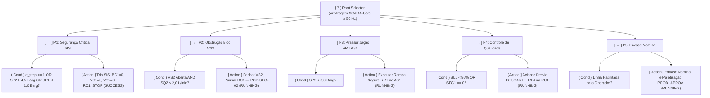

# Aula 25: Árvores de Comportamento (*Behavior Trees*) no Controle Reativo do SCADA-Core

### Informações do Projeto

| Parâmetro | Detalhe |
| :--- | :--- |
| **Unidade Industrial** | Linha Automatizada de Envase e Inspeção de Bebidas (Módulos 1 a 6 — Grupo 3) |
| **Aplicação** | Orquestração Reativa Hierárquica a $50\text{ Hz}$: Segurança SIS (`R-03`/`R-04`/`R-09`), Obstrução (`VS2`), Partida `RRT` (`AS1`), Qualidade (`SL1`/`SFC1`) e Envase Nominal |
| **Método Formulado** | *Behavior Trees* (BT) com Memória Compartilhada (*Blackboard*) e Varredura por *Tick* |
| **Código do Projeto** | `ECAA08-SISTEMA-SCADA-GRUPO3` |

---

## 1. Analogia Intuitiva — Por que usar Behavior Trees em vez de Máquinas de Estados (FSM)?

Na **Linha Automatizada de Envase e Inspeção de Bebidas (`SCADA-Core`)**, o CLP precisa tomar decisões a cada $20\text{ ms}$ ($50\text{ Hz}$) sobre múltiplos eventos que podem ocorrer ao mesmo tempo:
1. Um alarme crítico do SIS (`e_stop`, sobrepressão `SP2` $\ge 4{,}5\text{ Barg}$ ou cavitação `SP1` $\le 1{,}0\text{ Barg}$).
2. Uma obstrução no bico de envase `VS2` (`SQ2` $\le 2{,}0\text{ L/min}$).
3. A necessidade de pressurizar o acumulador `AS1` com a receita segura do planejador `RRT` (Aula 22) quando `SP2` $< 3{,}0\text{ Barg}$.
4. O descarte de uma garrafa fora do padrão (`SL1` $< 95\%$ ou tampa ausente em `SFC1`).
5. A operação nominal de envase e paletização sobre a esteira `RC1`.

Se modelarmos isso com uma **Máquina de Estados Finitos (FSM)** tradicional, toda vez que adicionamos uma nova regra de segurança precisamos criar setas de transição saindo de **todos** os estados antigos para o novo estado — gerando uma explosão de conexões de complexidade $\mathcal{O}(N^2)$ difícil de manter e auditar.

As **Árvores de Comportamento (*Behavior Trees* — BT)** resolvem isso organizando o controle como uma **lista de prioridades hierárquica** lida sempre da esquerda para a direita a cada pulso de relógio (**Tick**). Se uma emergência acontecer no meio da partida ou do envase, o ramo mais à esquerda assume o controle imediatamente (**preempção**), sem precisar desenhar dezenas de transições cruzadas.

---

## 2. Como Funciona a Matemática das Behavior Trees

Uma *Behavior Tree* é uma árvore enraizada ordenada $T = (V, E, \tau)$ que lê e escreve dados no ***Blackboard*** (memória compartilhada $\mathcal{B}$ com as leituras dos sensores ISA-5.1). A cada *Tick* ($50\text{ Hz}$), todo nó devolve um dos três estados do conjunto ternário:

$$\mathcal{S}_{\text{BT}} = \{\texttt{SUCCESS}, \; \texttt{FAILURE}, \; \texttt{RUNNING}\}$$

### 2.1 Nós de Controle (*Composites*)

Para uma lista ordenada de $m$ filhos $(c_1, c_2, \dots, c_m)$:

1. **Seletor / *Fallback* (`?` — Disjunção Priorizada em Curto-Circuito):**
   Testa os ramos da esquerda ($c_1$, maior prioridade) para a direita ($c_m$, menor prioridade) e **para imediatamente** no primeiro filho que retornar `SUCCESS` ou `RUNNING`:

$$\text{Selector}(c_1, \dots, c_m) = \begin{cases} \texttt{SUCCESS}, & \text{se } \exists k \in \{1..m\} : S(c_k) = \texttt{SUCCESS} \land \forall j < k, S(c_j) = \texttt{FAILURE} \\ \texttt{RUNNING}, & \text{se } \exists k \in \{1..m\} : S(c_k) = \texttt{RUNNING} \land \forall j < k, S(c_j) = \texttt{FAILURE} \\ \texttt{FAILURE}, & \text{se } \forall j \in \{1..m\}, \; S(c_j) = \texttt{FAILURE} \end{cases}$$

2. **Sequência (`→` — Conjunção Ordenada em Curto-Circuito):**
   Exige que cada passo (pré-requisito) dê `SUCCESS` antes de passar ao próximo. Se qualquer filho retornar `FAILURE` ou estiver em andamento (`RUNNING`), ela retorna esse status imediatamente:

$$\text{Sequence}(c_1, \dots, c_m) = \begin{cases} \texttt{FAILURE}, & \text{se } \exists k \in \{1..m\} : S(c_k) = \texttt{FAILURE} \land \forall j < k, S(c_j) = \texttt{SUCCESS} \\ \texttt{RUNNING}, & \text{se } \exists k \in \{1..m\} : S(c_k) = \texttt{RUNNING} \land \forall j < k, S(c_j) = \texttt{SUCCESS} \\ \texttt{SUCCESS}, & \text{se } \forall j \in \{1..m\}, \; S(c_j) = \texttt{SUCCESS} \end{cases}$$

### 2.2 Nós Folha (*Execution Nodes*)
* **Condição (`Condition`):** Verifica uma regra booleana no *Blackboard* em $\mathcal{O}(1)$ sem alterar atuadores. Retorna apenas `SUCCESS` ou `FAILURE`.
* **Ação (`Action`):** Comanda os atuadores da linha (`BC1`, `VS1`, `VS2`, `VALV_Alivio`, esteira `RC1`). Retorna `RUNNING` enquanto o processo está ativo, `SUCCESS` quando conclui um bloqueio/tarefa ou `FAILURE` se não puder executar.

---

## 3. Topologia da Behavior Tree da Linha de Envase (Mermaid)

---

## 4. Matriz de Preempção Determinística em 6 Cenários de Campo

| Tick | Cenário Injetado no *Blackboard* | Ramo Ativado (Preempção) | Status da Raiz | Comando na Esteira `RC1` e Atuadores |
| :---: | :--- | :--- | :---: | :--- |
| **1** | Operação nominal (`SP2=3,8`, `SQ2=5,0`, `SL1=98%`, `SFC1=1`) | **P5:** `Envase Nominal` | `RUNNING` | `PROD_APROV_NOMINAL` (`RC1 = 0,4 m/s`) |
| **2** | Garrafa com nível baixo (`SL1=91%`) durante envase | **P4:** `Qualidade` (preempta P5) | `RUNNING` | `DESCARTE_REJ` (`RC1 = 0,3 m/s`, desvio) |
| **3** | Partida matinal com `AS1` baixo (`SP2=2,2 Barg`) | **P3:** `Partida RRT` (preempta P4..P5) | `RUNNING` | `PARTIDA_RRT_AS1` (`VS2=0`, `BC1=1`, `RC1=0,1 m/s`) |
| **4** | Bico `VS2` obstruído (`SQ2=1,4 L/min` c/ `VS2=1`) | **P2:** `Obstrução` (preempta P3..P5) | `RUNNING` | `PAUSA_OBSTRUCAO_VS2` (`VS2=0`, `RC1=0,0 m/s`) |
| **5** | Sobrepressão `SP2=4,7 Barg` (mesmo com obstrução e nível baixo) | **P1:** `SIS Crítico` (preempta TODOS) | `SUCCESS` | **`TRIP_SIS_PARADA`** (`BC1=0`, `VALV_Alivio=1`, `RC1=0,0`) |
| **6** | Linha desabilitada pelo operador sem alarmes ativos | Nenhum ramo habilitado | `FAILURE` | `IDLE_ESPERA` (Parada segura em repouso) |

> [!NOTE]
> **Curto-circuito de tempo real:** No Tick 5 (sobrepressão em `AS1`), a Behavior Tree avalia apenas **2 nós** (`Cond_SIS_Critico` e `Act_Trip_SIS`) e corta imediatamente bomba, válvulas e esteira, ignorando os ramos de menor prioridade.

---

## 5. Escopo e Limitações do Modelo

1. **Custo de Varredura a $50\text{ Hz}$:** Como a árvore embarcada da linha de envase possui $16$ nós ($1$ raiz, $5$ sequências e $10$ folhas), a varredura completa consome menos de $10\text{ }\mu\text{s}$ — irrelevante frente ao período de varredura de $20\text{ ms}$ ($50\text{ Hz}$) do CLP.
2. **Limpeza de Estado em Preempção (`halt()`):** Quando um ramo prioritário (ex.: P1 — Trip SIS ou P2 — Obstrução) interrompe uma ação `RUNNING` (ex.: P3 — Partida RRT), o controlador deve invocar a rotina de *reset* dos integradores PID e travar os comandos de saída para evitar *windup* no retorno à operação.

---

## 6. Referências Técnicas

1. COLLEDANCHISE, M.; ÖGREN, P. **Behavior Trees in Robotics and AI: An Introduction**. Boca Raton: CRC Press, 2018.
2. MACENSKI, S. et al. The Marathon 2: A Navigation System (ROS 2 Nav2 with Behavior Trees). **IEEE/RSJ International Conference on Intelligent Robots and Systems (IROS)**, 2020.
3. ISA — INTERNATIONAL SOCIETY OF AUTOMATION. **ANSI/ISA-5.1: Instrumentation Symbols and Identification**. Research Triangle Park, NC, 2009.
4. IEC. **IEC 61511: Functional Safety — Safety Instrumented Systems for the Process Industry Sector**. Geneva: IEC, 2016.
5. Grupo 3 — ECAA08. **Aula 10: Motor de Intertravamento e Diagnóstico; Aula 21: Árvores Binárias; Aula 22: Rapidly-exploring Random Trees**. UNIFEI, 2026.