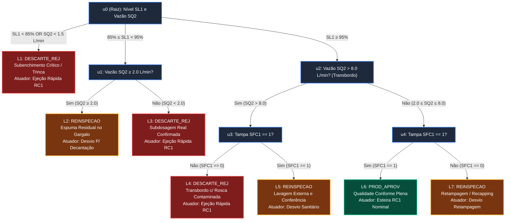
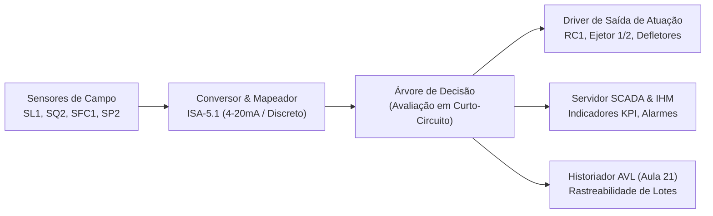

# Aula 27: Árvores de Decisão na Triagem e Inspeção de Qualidade do SCADA-Core

### Informações do Projeto

| Parâmetro | Detalhe |
| :--- | :--- |
| **Unidade Industrial** | Linha Automatizada de Envase e Inspeção de Bebidas (Módulos 1 a 6 — Grupo 3) |
| **Aplicação** | Árvore de Decisão Determinística para Classificação Operacional de Garrafas: Aprovação (`PROD_APROV`), Rejeição (`DESCARTE_REJ`) e Encaminhamento para Reinspeção (`REINSPECAO`) |
| **Fundamentação Matemática** | Teoria dos Grafos (Arborescências e Árvores Enraizadas), Particionamento de Conjuntos, Lógica Proposicional e Formas Normais Disjuntivas (FND) |
| **Código do Projeto** | `ECAA08-SISTEMA-SCADA-GRUPO3` |

---

## 1. Introdução e Contextualização no Projeto do Grupo 3

Na automação industrial moderna e na engenharia de processos contínuos, sistemas de supervisão e controle (*SCADA — Supervisory Control and Data Acquisition*) dependem de algoritmos de tomada de decisão que apresentem **determinismo temporal estrito**, **auditabilidade matemática** e **interpretabilidade inequívoca**. 

Na **Linha Automatizada de Envase e Inspeção de Bebidas (SCADA-Core — Grupo 3)**, cada unidade física de produto (garrafa PET de bebida gaseificada) percorre sequencialmente os postos de trabalho tracionada pela Esteira Transportadora (`RC1`). Ao longo desse trajeto, a garrafa é submetida a operações críticas de processo e controle de qualidade:
1. **Alimentação e Pressurização Hidráulica (Módulo 2):** O fluido é extraído do Tanque de Suprimento (`TS1`) pela Válvula de Sucção (`VS1`), impulsionado pela Bomba Centrífuga (`BC1`) e amortecido pelo Acumulador de Suprimento (`AS1`), monitorado pelo sensor de pressão `SP2`.
2. **Dosagem Volumétrica e Envasamento (Módulo 3):** A injeção de fluido é executada pela Válvula de Envase (`VS2`), com monitoramento em tempo real da vazão pelo sensor de vazão `SQ2` (faixa nominal de dosagem de $2{,}0$ a $8{,}0\text{ L/min}$).
3. **Inspeção Óptica de Nível de Enchimento (Módulo 4):** A Válvula Solenoide `VS3` estende o mecanismo de posicionamento do sensor de nível óptico/laser `SL1`. A cota de preenchimento é considerada aprovada se atingir $\ge 95\%$ do volume nominal ($l_{\text{min}} = 1$).
4. **Tampagem Mecânica e Selagem (Módulo 5):** O mecanismo de descida atua via solenoide `VS4`, e o Atuador de Capping (`AC1`) realiza o aperto e rosqueamento da tampa plástica sob torque controlado.
5. **Inspeção de Integridade da Selagem e Vedação (Módulo 6):** A solenoide `VS5` estende o apalpador táctil com o sensor fim de curso `SFC1`. Se a tampa estiver presente e na cota correta de assentamento, o contato fecha ($x_{\text{fc}} = 1$); caso contrário ($x_{\text{fc}} = 0$), registra-se ausência ou falha de selagem.
6. **Módulo de Triagem e Desvio Automatizado:** Ao final da linha de inspeção na esteira `RC1`, o sistema SCADA deve enviar um comando eletromecânico para posicionar a garrafa em um dos três destinos operacionais:
   - **Aprovação (`PROD_APROV`):** A garrafa atendeu integralmente a todos os requisitos metrológicos e de vedação, seguindo livre pela esteira `RC1` em velocidade nominal ($0{,}4\text{ m/s}$) para a célula de paletização e embalagem final.
   - **Rejeição e Descarte Definitivo (`DESCARTE_REJ`):** A garrafa apresenta defeito crítico irreversível (por exemplo, subenchimento severo decorrente de fissura na carcaça plástica, ou transbordo com tampa faltante gerando contaminação externa). O cilindro pneumático de ejeção rápida desvia a garrafa para a caçamba de reciclagem.
   - **Encaminhamento para Reinspeção ou Retrabalho (`REINSPECAO`):** A garrafa apresenta uma incerteza de medição recuperável (por exemplo, leitura de nível marginal decorrente de espuma temporária no menisco) ou um defeito recuperável que não contaminou a bebida (nível plenamente conforme, mas falha no rosqueamento da tampa). O defletor desvia a garrafa suavemente para uma linha auxiliar de decantação ou para o carrossel de retampagem automática (*recapping*), preservando o fluido nobre e reduzindo custos e desperdício de insumos.

O objetivo fundamental da **Aula 27** é modelar formalmente esse processo decisório sob a ótica da **Matemática Discreta**. Em contraste com abordagens de aprendizado de máquina supervisionado (*Machine Learning*, como indução empírica de árvores com Scikit-Learn baseada em divisão estocástica de conjuntos de dados), tratamos as **Árvores de Decisão (*Decision Trees*)** como estruturas discretas exatas: grafos orientados acíclicos enraizados dotados de predicados lógicos em seus nós internos e decisões determinísticas em suas folhas. Essa abordagem garante auditabilidade total conforme as normas **ANSI/ISA-5.1**, **IEC 61131-3** e **IEC 61508 / IEC 61511**.

---

## 2. Fundamentação Teórica: Grafos e Estruturas em Árvores

Na teoria dos grafos, as árvores constituem uma das classes mais fundamentais de estruturas de dados discretas. Para fundamentar as árvores de decisão, estabelecemos as seguintes definições matemáticas formais.

### 2.1. Grafos Orientados e Arborescências

Um **grafo direcionado (ou dígrafo)** é um par ordenado $G = (V, E)$, onde $V$ é um conjunto finito e não vazio de **vértices (ou nós)** e $E \subseteq V \times V$ é um conjunto de pares ordenados $(u, v)$ denominados **arestas direcionadas (ou arcos)**, com origem em $u$ e destino em $v$.

* **Grau de Entrada e Saída:** Para qualquer vértice $v \in V$:
  $$\text{grau}^-(v) = |\{u \in V \mid (u, v) \in E\}| \quad \text{(número de arestas que entram em } v\text{)}$$
  $$\text{grau}^+(v) = |\{w \in V \mid (v, w) \in E\}| \quad \text{(número de arestas que saem de } v\text{)}$$

* **Caminho Direcionado Simples:** Uma sequência de vértices distintos $\pi = (v_0, v_1, \dots, v_k)$ tal que $(v_{i-1}, v_i) \in E$ para todo $i \in \{1, \dots, k\}$. O comprimento do caminho é $k$, correspondendo ao número de arestas percorridas.

* **Definição Formal de Árvore Enraizada Orientada (Arborescência):**
  Uma arborescência é um dígrafo conexo e acíclico $T = (V, E, r)$ dotado de um vértice especial $r \in V$ denominado **raiz**, que satisfaz as três propriedades axiomáticas fundamentais:
  1. A raiz possui grau de entrada nulo: $\text{grau}^-(r) = 0$.
  2. Todo vértice $v \in V \setminus \{r\}$ possui exatamente grau de entrada unitário: $\text{grau}^-(v) = 1$.
  3. Para qualquer vértice $v \in V$, existe **um e apenas um** caminho direcionado simples partindo da raiz $r$ e terminando em $v$, denotado por $\pi(r, v)$.

### 2.2. Elementos Constituintes da Árvore

O conjunto de vértices de uma arborescência $V$ decompõe-se de maneira disjunta em duas classes fundamentais:

$$V = V_I \;\dot{\cup}\; V_L \quad (V_I \cap V_L = \emptyset)$$

1. **Nós Internos ($V_I$):** Vértices com grau de saída não nulo:
   $$V_I = \{v \in V \mid \text{grau}^+(v) \ge 1\}$$
   Em uma árvore de decisão, cada nó interno $u \in V_I$ representa um **nó de decisão**, no qual é avaliado um predicado ou teste sobre o estado dos sensores da planta. O valor de $\text{grau}^+(u) = m_u \ge 2$ define a aridade da ramificação em $u$.
2. **Folhas ou Nós Terminais ($V_L$):** Vértices com grau de saída estritamente nulo:
   $$V_L = \{v \in V \mid \text{grau}^+(v) = 0\}$$
   Em uma árvore de decisão, cada nó folha $\ell \in V_L$ encerra o fluxo decisório e contém o rótulo de uma **decisão operacional final** atribuída ao produto.
3. **Níveis e Profundidade:**
   A profundidade de um vértice $v$, denotada por $\text{prof}(v)$, é definida como o comprimento do único caminho simples da raiz até ele:
   $$\text{prof}(v) = |\pi(r, v)| - 1$$
   Por definição, $\text{prof}(r) = 0$. O conjunto de vértices com profundidade idêntica $k$ constitui o **nível $k$** da árvore.
4. **Altura da Árvore ($h$):**
   A altura da árvore $h(T)$ corresponde à profundidade máxima entre todos os seus vértices (que ocorre necessariamente em uma folha):
   $$h(T) = \max_{v \in V} \text{prof}(v) = \max_{\ell \in V_L} \text{prof}(\ell)$$
5. **Subárvore:**
   Para qualquer nó $u \in V$, a subárvore enraizada em $u$, denotada por $T_u = (V_u, E_u, u)$, é o subgrafo induzido em $T$ constituído por $u$ e todos os seus descendentes diretos e indiretos (isto é, todos os vértices $w \in V$ tais que existe um caminho direcionado de $u$ até $w$).
6. **Condição de Parada:**
   O processo de caminhamento pela árvore tem condição de parada determinística e obrigatória: a parada ocorre no instante em que se atinge um nó cujo conjunto de filhos é vazio ($\text{grau}^+(v) = 0$), isto é, uma folha. Não existem ciclos ou retenções indefinidas, o que assegura a terminação estrita do algoritmo em no máximo $h(T)$ passos.

---

## 3. Estrutura Matemática das Árvores de Decisão

Formalizamos a árvore de decisão como uma estrutura de dados matemática que conecta a álgebra proposicional, a teoria de conjuntos e a engenharia de controle.

### 3.1. Definição Formal da 8-Tupla

Uma **Árvore de Decisão** é definida formalmente pela 8-tupla:

$$\mathcal{T} = \left( V, E, r, \mathcal{X}, \mathcal{P}, \mathcal{D}, \phi_V, \phi_E, \phi_L \right)$$

Onde:
* $V = V_I \;\dot{\cup}\; V_L$ é o conjunto finito de nós;
* $E \subset V_I \times V$ é o conjunto de arestas direcionadas;
* $r \in V_I$ é o nó raiz inicial;
* $X$ é o **espaço de estados de atributos** do produto inspecionado, definido pelas medições dos sensores da linha de bebidas:

$$
x = (SL1, SQ2, SFC1, SP2) \in X \subseteq R_{\geq 0} \times R_{\geq 0} \times \{0,1\} \times R_{\geq 0}
$$
* $\mathcal{P} = \{P_1, P_2, \dots, P_k\}$ é o conjunto de predicados de teste baseados nas grandezas de engenharia;
* $D = \{PROD\_APROV,\; DESCARTE\_REJ,\; REINSPECAO\}$ é o conjunto finito de decisões operacionais possíveis no SCADA;
* $\phi_V: V_I \to \mathcal{P}$ é a função que associa a cada nó interno de decisão o predicado a ser inspecionado;
* $\phi_E: E \to \mathcal{C}$ é a função que rotula cada aresta $(u, v) \in E$ com a condição lógica (resultado do teste) que habilita a transição de $u$ para o filho $v$;
* $\phi_L: V_L \to \mathcal{D}$ é a função que mapeia univocamente cada nó folha a uma decisão operacional final.

### 3.2. Particionamento Exato do Espaço de Estados (Teoria dos Conjuntos)

Considere o universo de todas as garrafas envasadas $\Omega \subseteq \mathcal{X}$. A cada nó interno $u \in V_I$, associamos um subconjunto $\Omega_u \subseteq \Omega$ contendo todas as instâncias que satisfazem a conjunção de condições do caminho desde a raiz até $u$. Para a raiz, temos $\Omega_r = \Omega$.

Se o nó $u$ possui $m$ arestas de saída $e_1 = (u, v_1), e_2 = (u, v_2), \dots, e_m = (u, v_m)$, com respectivas condições $\mathcal{C}(e_1), \dots, \mathcal{C}(e_m)$, as condições devem satisfazer duas propriedades axiomáticas fundamentais da teoria dos conjuntos:

1. **Exclusão Mútua (Disjunção Estrita):**
   $$\Omega_{v_i} \cap \Omega_{v_j} = \emptyset \quad \forall \; i \ne j$$
   Nenhuma garrafa pode satisfazer simultaneamente mais de um ramo saindo do mesmo nó de decisão.
2. **Exaustividade Coletiva (Cobertura Plena):**
   $$\bigcup_{i=1}^{m} \Omega_{v_i} = \Omega_u$$
   Toda garrafa que chega ao nó $u$ é obrigatoriamente roteada para exatamente um dos nós filhos.

Dessa forma, o conjunto de todas as folhas $V_L = \{\ell_1, \ell_2, \dots, \ell_L\}$ induz um **particionamento exato** do espaço global de possibilidades $\Omega$:

$$\Omega = \bigcup_{\ell \in V_L} \Omega_{\ell}, \qquad \text{com } \Omega_{\ell_i} \cap \Omega_{\ell_j} = \emptyset \; (\forall i \ne j)$$

Cada folha $\ell \in V_L$ representa uma região conexa ou bloco da partição do espaço de atributos.

### 3.3. Equivalência com a Lógica Proposicional: Caminhos e Formas Normais

Existe uma correspondência isomórfica direta entre a topologia da árvore de decisão e a lógica proposicional formal (estudada na Aula 04 e na Aula 05 do Grupo 3):

#### A. Regra de Decisão de um Caminho (Cláusula Conjuntiva — AND)
Para cada nó folha $\ell \in V_L$, existe um único caminho direcionado $\pi(r, \ell) = (e_1, e_2, \dots, e_p)$, onde $e_k = (u_{k-1}, u_k)$. A regra de ativação dessa folha, denotada por $\mathcal{R}_\ell(\mathbf{x})$, é a **conjunção lógica estrita** de todas as condições ao longo do percurso:

$$\mathcal{R}_\ell(\mathbf{x}) = \bigwedge_{k=1}^{p} \phi_E(e_k) = \phi_E(e_1) \land \phi_E(e_2) \land \dots \land \phi_E(e_p)$$

Essa conjunção é verdadeira se e somente se o produto $\mathbf{x}$ satisfaz simultaneamente todos os predicados intermediários que conduzem à folha $\ell$.

#### B. Regra Global de uma Decisão Operacional (Forma Normal Disjuntiva — FND)
Uma decisão operacional $d \in \mathcal{D}$ (por exemplo, $d = \texttt{REINSPECAO}$) pode ser alcançada através de múltiplas folhas distintas na árvore. A regra global para que uma decisão $d$ seja emitida pelo SCADA é dada pela **disjunção das regras conjuntivas** de todas as folhas mapeadas para $d$:

$$\text{Decisão}(\mathbf{x}) = d \iff \bigvee_{\substack{\ell \in V_L \\ \phi_L(\ell) = d}} \mathcal{R}_\ell(\mathbf{x}) = \bigvee_{\substack{\ell \in V_L \\ \phi_L(\ell) = d}} \left( \bigwedge_{(u, v) \in \pi(r, \ell)} \phi_E(u, v) \right)$$

Essa expressão matemática constitui formalmente uma **Forma Normal Disjuntiva (FND / DNF — *Disjunctive Normal Form*)**, onde cada termo é um mintermo generalizado formado por conjunções de predicados, e a expressão total é uma disjunção de tais mintermos.

---

## 4. Topologia da Árvore de Decisão da Linha de Envase (Grupo 3)

### 4.1. Definição das Variáveis e Predicados de Processo

Com base no catálogo de instrumentação ISA-5.1 consolidado no projeto do Grupo 3 (Mapeamento de Variáveis e Aula 10), definimos as variáveis e os limites operacionais utilizados nos predicados de decisão:

| Tag | Instrumento | Tipo de Medição | Faixa de Trabalho | Limiares de Decisão | Significado Físico no Envase |
| :---: | :--- | :--- | :---: | :---: | :--- |
| **SL1** | Sensor Óptico de Nível | Porcentagem ($\%$) | $0$ a $100\%$ | $\text{SL1} < 85\%$ $85\% \le \text{SL1} < 95\%$ $\text{SL1} \ge 95\%$ | Subenchimento Crítico (vazamento/defeito frasco) Zona Marginal (possível espuma residual) Nível Conforme ($l_{\text{min}} = 1$) |
| **SQ2** | Sensor de Vazão de Envase | Analógico ($\text{L/min}$) | $0$ a $20\text{ L/min}$ | $\text{SQ2} < 1{,}5\text{ L/min}$ $\text{SQ2} < 2{,}0\text{ L/min}$ $2{,}0 \le \text{SQ2} \le 8{,}0$ $\text{SQ2} > 8{,}0\text{ L/min}$ | Falha Severa no Bico `VS2` Subdosagem Efetiva ($q_{\text{min2}}$) Vazão Nominal de Dosagem Sobredosagem / Risco de Transbordo ($q_{\text{max2}}$) |
| **SFC1** | Sensor Fim de Curso | Digital Discreto | $\{0, 1\}$ | $x_{\text{fc}} = 1$ $x_{\text{fc}} = 0$ | Tampa Assentada e Selada Corretamente Tampa Ausente ou Mal Rosqueada |
| **SP2** | Pressão do Acumulador AS1 | Analógico ($\text{Barg}$) | $0$ a $10\text{ Barg}$ | $3{,}0 \le \text{SP2} \le 4{,}5$ | Estabilidade da Pressão de Envase |

### 4.2. Estrutura dos Nós de Decisão e Ramificações

A árvore projetada possui aridade mista:
1. **Nó Raiz ($u_0$ — Avaliação Primária de Nível e Vazão Crítica):**
   - **Ramo 1:** $\text{SL1} < 85\% \lor \text{SQ2} < 1{,}5\text{ L/min}$ $\implies$ Subenchimento severo irrecuperável $\to$ Folha $L_1$: `DESCARTE_REJ`.
   - **Ramo 2:** $85\% \le \text{SL1} < 95\%$ $\implies$ Zona marginal de preenchimento $\to$ Direciona ao nó de decisão $u_1$.
   - **Ramo 3:** $\text{SL1} \ge 95\%$ $\implies$ Menisco atingiu a especificação nominal $\to$ Direciona ao nó de decisão $u_2$.
2. **Nó de Decisão $u_1$ (Avaliação de Vazão na Faixa Marginal de Nível):**
   - **Ramo 1:** $\text{SQ2} \ge 2{,}0\text{ L/min}$ $\implies$ A vazão de dosagem foi nominal, indicando que o nível aparente abaixo de $95\%$ deve-se à formação temporária de espuma no gargalo $\to$ Folha $L_2$: `REINSPECAO` (desvio suave para pulmão de decantação de espuma e nova leitura).
   - **Ramo 2:** $\text{SQ2} < 2{,}0\text{ L/min}$ $\implies$ Subdosagem hidráulica real comprovada pelo fluxômetro $\to$ Folha $L_3$: `DESCARTE_REJ` (rejeição metrológica).
3. **Nó de Decisão $u_2$ (Avaliação de Transbordo com Nível Conforme):**
   - **Ramo 1:** $\text{SQ2} > 8{,}0\text{ L/min}$ ($q_{\text{max2}}$) $\implies$ Injeção excessiva com transbordo de líquido para o exterior do gargalo $\to$ Direciona ao nó $u_3$.
   - **Ramo 2:** $2{,}0 \le \text{SQ2} \le 8{,}0\text{ L/min}$ $\implies$ Dosagem volumétrica perfeitamente dentro da faixa nominal $\to$ Direciona ao nó $u_4$.
4. **Nó de Decisão $u_3$ (Inspeção de Vedação em Condição de Transbordo):**
   - **Ramo 1:** $\text{SFC1} = 0$ ($x_{\text{fc}} = 0$) $\implies$ Transbordo associado à ausência de tampa acarreta contaminação irrecuperável da rosca $\to$ Folha $L_4$: `DESCARTE_REJ`.
   - **Ramo 2:** $\text{SFC1} = 1$ ($x_{\text{fc}} = 1$) $\implies$ Tampa devidamente selada; o produto interno está protegido, mas o frasco requer higienização externa e conferência ponderal $\to$ Folha $L_5$: `REINSPECAO` (módulo de lavagem externa de gargalo e reinspeção de peso).
5. **Nó de Decisão $u_4$ (Inspeção de Vedação em Condição Nominal de Enchimento):**
   - **Ramo 1:** $\text{SFC1} = 1$ ($x_{\text{fc}} = 1$) $\implies$ Garrafa com nível e selagem impecáveis $\to$ Folha $L_6$: `PROD_APROV` (liberação para paletização).
   - **Ramo 2:** $\text{SFC1} = 0$ ($x_{\text{fc}} = 0$) $\implies$ O volume de líquido está perfeito e não houve transbordo, mas a tampa falhou no cabeçote de capping $\to$ Folha $L_7$: `REINSPECAO` (encaminhamento para retampagem automática / *recapping*, reaproveitando integralmente o produto).

### 4.3. Diagrama Topológico em Mermaid

### 4.4. Tabela de Mapeamento Completo de Folhas e Ações SCADA

A tabela a seguir consolida o percurso de cada folha, sua expressão booleana conjuntiva, a decisão operacional atribuída e os comandos de saída sobre os atuadores da linha de bebidas:

| Folha (ℓ) | Caminho (π(r, ℓ)) | Expressão Conjuntiva (Rℓ(x)) | Decisão (φL(ℓ)) | Ação nos Atuadores (`RC1`, Pistões, Alarmes) | Justificativa Técnica de Engenharia |
| :---: | :---: | :--- | :---: | :--- | :--- |
| **$L_1$** | $(u_0)$ | $SL1 < 85\% \lor SQ2 < 1{,}5$ | `DESCARTE_REJ` | Pistão Ejetor 1 = ATIVO, `RC1` = $0{,}4$ m/s, Alarme = Nível Crítico | Volume severamente abaixo do padrão metrológico ou vazamento por trinca plástica. |
| **$L_2$** | $(u_0,u_1)$ | $(85\% \leq SL1 < 95\%) \land (SQ2 \geq 2{,}0)$ | `REINSPECAO` | Defletor Pulmão = ATIVO, `RC1` = $0{,}2$ m/s, Alarme = Aviso Espuma | O bico injetou volume nominal; a medição de nível foi atenuada por espuma. Reavaliação após decantação. |
| **$L_3$** | $(u_0,u_1)$ | $(85\% \leq SL1 < 95\%) \land (SQ2 < 2{,}0)$ | `DESCARTE_REJ` | Pistão Ejetor 1 = ATIVO, `RC1` = $0{,}4$ m/s, Alarme = Falha Dosagem | A baixa vazão comprova subdosagem real. A garrafa não atinge a tolerância legal do Inmetro. |
| **$L_4$** | $(u_0,u_2,u_3)$ | $(SL1 \geq 95\%) \land (SQ2 > 8{,}0) \land (SFC1 = 0)$ | `DESCARTE_REJ` | Pistão Ejetor 2 = ATIVO, `RC1` = $0{,}4$ m/s, Alarme = Transbordo Grave | Transbordo de xarope sobre gargalo desprovido de tampa provoca contaminação bacteriana externa irrecuperável. |
| **$L_5$** | $(u_0,u_2,u_3)$ | $(SL1 \geq 95\%) \land (SQ2 > 8{,}0) \land (SFC1 = 1)$ | `REINSPECAO` | Defletor Lavagem = ATIVO, `RC1` = $0{,}2$ m/s, Alarme = Aviso Higiene | A selagem foi concluída com sucesso, mas o fluido extravasado exige lavagem externa de carcaça e conferência. |
| **$L_6$** | $(u_0,u_2,u_4)$ | $(SL1 \geq 95\%) \land (2{,}0 \leq SQ2 \leq 8{,}0) \land (SFC1 = 1)$ | `PROD_APROV` | Esteira `RC1` = $0{,}4$ m/s (Livre para Paletizadora), Alarme = NENHUM | Garrafa $100\%$ conforme em volume e vedação mecânica. |
| **$L_7$** | $(u_0,u_2,u_4)$ | $(SL1 \geq 95\%) \land (2{,}0 \leq SQ2 \leq 8{,}0) \land (SFC1 = 0)$ | `REINSPECAO` | Defletor Capping = ATIVO, `RC1` = $0{,}2$ m/s, Alarme = Aviso Tampa | O fluido envasado é nobre e está intacto; apenas a tampa ausente precisa ser colocada pelo cabeçote `AC1`. |

---

## 5. Análise Matemática e Computacional da Árvore

Nesta seção, estabelecemos a distinção rigorosa entre as propriedades universais das árvores e as características de árvores binárias ou árvores gerais, aplicando os teoremas clássicos de Matemática Discreta.

### 5.1. Teorema das Arestas em Árvores Gerais

**Teorema 1:** *Qualquer árvore (ou arborescência) finita T = (V, E), contendo N vértices, possui exatamente N − 1 arestas.*

*Demonstração:* Na arborescência, por definição, todo vértice $v \in V \setminus \{r\}$ possui grau de entrada exatamente igual a 1 ($\text{grau}^-(v) = 1$), enquanto a raiz possui $\text{grau}^-(r) = 0$. Como cada aresta contribui com exatamente uma unidade para o grau de entrada de algum vértice:
$$|E| = \sum_{v \in V} \text{grau}^-(v) = \text{grau}^-(r) + \sum_{v \in V \setminus \{r\}} \text{grau}^-(v) = 0 + \sum_{v \in V \setminus \{r\}} 1 = |V| - 1 \quad \blacksquare$$

Na árvore da linha de envase do Grupo 3:
* Conjunto de nós internos: $V_I = \{u_0, u_1, u_2, u_3, u_4\} \implies |V_I| = 5$.
* Conjunto de folhas: $V_L = \{L_1, L_2, L_3, L_4, L_5, L_6, L_7\} \implies |V_L| = 7$.
* Total de vértices: $|V| = |V_I| + |V_L| = 5 + 7 = 12$.
* Total de arestas: $|E| = |V| - 1 = 12 - 1 = 11$ arestas.

### 5.2. Análise de Aridade: Árvores $m$-árias Estritas vs. Árvores Gerais Heterogêneas

Existe uma confusão conceitual comum que deve ser explicitamente evitada em engenharia: **as relações numéricas válidas para árvores binárias ou $m$-árias estritas não se aplicam indiscriminadamente a qualquer árvore.**

1. **Árvores $m$-árias Estritas (Cheias):**
   Em uma árvore onde *todo* nó interno possui exatamente $m$ filhos ($\text{grau}^+(u) = m$ para todo $u \in V_I$), a contagem total de arestas que saem dos nós internos é $m \cdot |V_I|$. Como $|E| = |V| - 1$ e $|V| = |V_I| + |V_L|$:
   $$m \cdot |V_I| = (|V_I| + |V_L|) - 1 \implies |V_L| = (m - 1)|V_I| + 1$$
   *Caso Particular — Árvore Binária Estrita (m = 2):*
   $$|V_L| = (2 - 1)|V_I| + 1 = |V_I| + 1$$
   O número de folhas é sempre igual ao número de nós internos mais um.

2. **Árvores de Decisão Gerais (Aridade Heterogênea):**
   Em uma árvore de decisão industrial realista, os testes nos nós internos podem possuir diferentes naturezas discretas: testes booleanos geram aridade 2, enquanto testes de faixas contínuas discretizadas (como o nó de nível $u_0$) geram aridades maiores ($m \ge 3$).
   Para uma árvore geral onde cada nó interno $u \in V_I$ possui grau de saída $m(u) = \text{grau}^+(u)$:
   $$|E| = \sum_{u \in V_I} m(u) = |V_I| + |V_L| - 1 \implies |V_L| = 1 + \sum_{u \in V_I} \big( m(u) - 1 \big)$$
   
   Na árvore de inspeção do Grupo 3:
   * Nó $u_0$: $m(u_0) = 3$ (Ramo Crítico, Ramo Marginal, Ramo Conforme);
   * Nós $u_1, u_2, u_3, u_4$: $m(u) = 2$ cada.
   
   Calculando formalmente o número de folhas:
   $$|V_L| = 1 + (3 - 1) + (2 - 1) + (2 - 1) + (2 - 1) + (2 - 1) = 1 + 2 + 1 + 1 + 1 + 1 = 7$$
   O resultado obtido confirma com precisão matemática as 7 folhas modeladas!

### 5.3. Altura, Profundidade e Complexidade de Avaliação Temporal

* **Profundidade por Folha:**
  - $\text{prof}(L_1) = 1$ (caminho: $u_0 \to L_1$);
  - $\text{prof}(L_2) = 2$ (caminho: $u_0 \to u_1 \to L_2$);
  - $\text{prof}(L_3) = 2$ (caminho: $u_0 \to u_1 \to L_3$);
  - $\text{prof}(L_4) = 3$ (caminho: $u_0 \to u_2 \to u_3 \to L_4$);
  - $\text{prof}(L_5) = 3$ (caminho: $u_0 \to u_2 \to u_3 \to L_5$);
  - $\text{prof}(L_6) = 3$ (caminho: $u_0 \to u_2 \to u_4 \to L_6$);
  - $\text{prof}(L_7) = 3$ (caminho: $u_0 \to u_2 \to u_4 \to L_7$).

* **Altura da Árvore:**
  $$h(T) = \max_{\ell \in V_L} \text{prof}(\ell) = 3$$

* **Número de Caminhos Possíveis:**
  Como existe um caminho único da raiz até cada vértice, o número total de caminhos de decisão da raiz às folhas é **estritamente igual ao número de folhas**:
  $$|\Pi_{\text{decisão}}| = |V_L| = 7$$

* **Complexidade Assintótica de Pior Caso:**
  Para avaliar o estado de qualquer garrafa que entra na estação de inspeção, o algoritmo do CLP percorre exatamente um caminho direcionado da raiz até uma folha.
  O tempo de execução no pior caso é proporcional à altura da árvore:
  Tₚᵢₒᵣ = O(h) = O(3) = O(1)

O tempo de execução no melhor caso (descarte imediato por nível crítico em `L1`) avalia apenas **1 nó de decisão**:

$$
T_{melhor} = 1 \text{ avaliação}
$$

### 5.4. Comparação: Árvore de Decisão vs. Tabela-Verdade Combinatória

Se tentássemos avaliar todas as combinações booleanas das grandezas de entrada através de uma tabela-verdade completa:
* Com 4 variáveis discretizadas ($SL1$ em 3 faixas, $SQ2$ em 3 faixas, $SFC1$ em 2 estados, $SP2$ em 2 estados), o espaço de combinações brutas totalizaria:
  $$N_{\text{comb}} = 3 \times 3 \times 2 \times 2 = 36 \text{ combinações}$$
* Em uma avaliação exaustiva sequencial sem estrutura em árvore, o controlador precisaria testar até 36 linhas de regras na pior hipótese.
* A **Árvore de Decisão hierárquica** realiza a avaliação em **curto-circuito (*short-circuit evaluation*)**: ela particiona o espaço de forma que no máximo $3$ testes são realizados para qualquer garrafa.
* Além disso, garrafas com defeito crítico evidente ($L_1$) são descartadas após a avaliação de um único predicado na raiz, liberando o processador e antecipando o acionamento do pistão ejetor antes que a garrafa avance na esteira.

### 5.5. Determinismo Temporal e Ciclo de Varredura do CLP

No sistema SCADA do Grupo 3, o ciclo de varredura (*scan cycle*) do CLP opera tipicamente entre $10\text{ ms}$ e $50\text{ ms}$ ($20\text{ Hz}$ a $100\text{ Hz}$).
A avaliação de uma árvore de decisão de profundidade $h = 3$ com predicados aritméticos simples consome no microprocessador industrial:

$$t_{\text{decisão}} < 0{,}02\text{ ms} \quad (20\text{ }\mu\text{s})$$

Isso representa menos de $0{,}2\%$ do período de varredura do CLP. Como a esteira `RC1` desloca-se a $v_{\text{máx}} = 0{,}4\text{ m/s}$, durante o intervalo de tomada de decisão a garrafa desloca-se:

$$\Delta x = v \cdot t_{\text{decisão}} \le 0{,}4\text{ m/s} \times 0{,}02 \times 10^{-3}\text{ s} = 8\times 10^{-6}\text{ m} = 0{,}008\text{ mm}$$

Esse deslocamento microscópico comprova que a decisão é praticamente instantânea frente à dinâmica mecânica da esteira, assegurando o disparo perfeitamente sincronizado dos atuadores de triagem.

---

## 6. Integração com a Arquitetura do Sistema SCADA-Core

A árvore de decisão não é um modelo matemático isolado; ela atua como o **motor central de lógica de qualidade** da Linha de Envase:

1. **Camada de Aquisição:** Sinais analógicos (4-20 mA dos sensores `SL1`, `SQ2`, `SP2`) e digitais (contato seco do sensor `SFC1`) são lidos nos módulos de entrada e validados contra falhas de circuito aberto/curto-circuito conforme a norma NAMUR NE 43.
2. **Camada de Inferência (Árvore de Decisão):** A árvore executa deterministamente a cada passagem de garrafa pelo feixe óptico de presença.
3. **Camada de Atuação:** Comandos digitais de 24V DC são encaminhados aos acionamentos pneumáticos dos defletores e pistões de rejeição.
4. **Camada de Supervisão (IHM):** A interface do operador exibe em tempo real:
   - Contador de Garrafas Aprovadas (`PROD_APROV`);
   - Contador de Garrafas Descartadas (`DESCARTE_REJ`);
   - Contador de Garrafas em Reinspeção/Retampagem (`REINSPECAO`);
   - Índice de Eficiência Global da Linha (*OEE — Overall Equipment Effectiveness*).
5. **Historiador de Processos (Árvore AVL — Aula 21):** Para cada garrafa classificada, o SCADA gera um registro com timestamp UNIX, os valores lidos de telemetria, o ID da folha alcançada ($\ell$) e o código de disposição, possibilitando rastreabilidade total de lote e análise de causa-raiz (*Root Cause Analysis*).

---

## 7. Matriz de Cenários Industriais e Validação Empírica

A tabela a seguir apresenta cinco cenários representativos de operação industrial testados no sistema de supervisão do Grupo 3:

| Cenário de Teste | Leitura `SL1` (%) | Leitura `SQ2` (L/min) | Estado `SFC1` | Pressão `SP2` (Barg) | Caminho Percorrido | Decisão SCADA | Atuação Operacional |
| :---: | :---: | :---: | :---: | :---: | :---: | :---: | :--- |
| **Cenário 1: Operação Nominal Perfeita** | $98{,}5\%$ | $5{,}20$ | $1$ | $3{,}85$ | $u_0 \to u_2 \to u_4 \to L_6$ | `PROD_APROV` | Esteira `RC1` a $0{,}4\text{ m/s}$; envio direto à paletizadora. |
| **Cenário 2: Espuma Transitória de Enchimento** | $91{,}0\%$ | $5{,}40$ | $1$ | $3{,}80$ | $u_0 \to u_1 \to L_2$ | `REINSPECAO` | Desvio para pulmão de repouso (decantação da espuma). |
| **Cenário 3: Subenchimento por Falha de Injeção** | $88{,}0\%$ | $1{,}80$ | $1$ | $3{,}20$ | $u_0 \to u_1 \to L_3$ | `DESCARTE_REJ` | Pistão ejetor descarta a garrafa para reciclagem. |
| **Cenário 4: Falha no Cabeçote de Capping** | $97{,}0\%$ | $4{,}90$ | $0$ | $3{,}90$ | $u_0 \to u_2 \to u_4 \to L_7$ | `REINSPECAO` | Desvio para retampagem automática (reaproveitamento do líquido). |
| **Cenário 5: Transbordo com Gargalo Contaminado** | $99{,}0\%$ | $8{,}60$ | $0$ | $4{,}40$ | $u_0 \to u_2 \to u_3 \to L_4$ | `DESCARTE_REJ` | Ejeção imediata para descarte sanitário. |

---

## 8. Conclusão e Consolidação da Etapa 03 (Árvores) no Grupo 3

A **Aula 27** consolida de maneira definitiva o estudo das **Estruturas em Árvores** aplicadas à Engenharia de Controle e Automação na Linha de Envase de Bebidas (`SCADA-Core` — Grupo 3). 

Ao longo da Etapa 03, investigamos como diferentes especializações da teoria dos grafos e das árvores resolvem problemas específicos de engenharia industrial:
* **Aula 19 (Árvores Geradoras Mínimas — Kruskal e Prim):** Otimização topológica de infraestrutura física, minimizando a extensão de eletrocalhas e barramentos industriais entre os tanques e estações da planta.
* **Aula 20 (Árvores de Huffman):** Compressão estatística sem perdas de pacotes telemétricos ISA-5.1 para otimização do uso de banda em redes de automação.
* **Aula 21 (Árvores Binárias — BDT e AVL):** Árvores de decisão binárias para intertravamentos SIS de segurança funcional em tempo constante $\mathcal{O}(1)$ e árvores balanceadas AVL para busca e indexação temporal no Historiador em $\mathcal{O}(\log_2 N)$.
* **Aula 22 (Rapidly-exploring Random Trees — RRT):** Planejamento cinodinâmico de partida segura e pressurização da linha evitando zonas proibidas de sobrepressão e cavitação.
* **Aula 23 (Protocolo STP / RSTP — IEEE 802.1w):** Prevenção de tempestades de broadcast (*broadcast storms*) em anéis Ethernet industriais mediante topologias ativas livres de ciclos.
* **Aula 24 (Árvores de Atingibilidade em Redes de Petri):** Verificação formal de propriedades dinâmicas da esteira `RC1`, assegurando ausência de travamentos (*deadlock*) e conservação de recursos.
* **Aula 25 (Árvores de Comportamento — *Behavior Trees*):** Orquestração reativa hierárquica por ticks a $50\text{ Hz}$ com preempção determinística em tempo real.
* **Aula 26 (Árvores KD — $k$-d Trees):** Partição espacial geométrica ortogonal para buscas multidimensionais de vizinhos mais próximos no plano de fase hidráulico (`SP2` $\times$ `SQ2`).
* **Aula 27 (Árvores de Decisão — *Decision Trees*):** Estrutura hierárquica discreta determinística para triagem e inspeção de garrafas com particionamento exato do espaço amostral, gerando regras em Forma Normal Disjuntiva (FND) com tempos de resposta de pior caso delimitados por $\mathcal{O}(h)$ e garantia total de auditabilidade de processo.

---

## 9. Referências Bibliográficas Técnicas

1. ROSEN, K. H. **Matemática Discreta e Suas Aplicações**. 7. ed. São Paulo: McGraw-Hill, 2014.
2. CORMEN, T. H.; LEISERSON, C. E.; RIVEST, R. L.; STEIN, C. **Algoritmos: Teoria e Prática**. 3. ed. Rio de Janeiro: Elsevier, 2012.
3. BONDY, J. A.; MURTY, U. S. R. **Graph Theory with Applications**. London: Macmillan, 1976.
4. SZWARCFITER, J. L. **Grafos e Algoritmos Computacionais**. 2. ed. Rio de Janeiro: Campus, 1986.
5. ISA — INTERNATIONAL SOCIETY OF AUTOMATION. **ANSI/ISA-5.1: Instrumentation Symbols and Identification**. Research Triangle Park, NC, 2009.
6. IEC — INTERNATIONAL ELECTROTECHNICAL COMMISSION. **IEC 61131-3: Programmable controllers — Part 3: Programming languages**. Geneva: IEC, 2013.
7. IEC — INTERNATIONAL ELECTROTECHNICAL COMMISSION. **IEC 61511: Functional safety — Safety instrumented systems for the process industry sector**. Geneva: IEC, 2016.
8. GRUPO 3 — ECAA08. **Aula 04: Lógica Proposicional, Conectivos e Permissivos; Aula 05: Formas Normais e Otimização Booleana; Aula 10: Motor de Intertravamento e Diagnóstico; Aula 21: Árvores Binárias**. Universidade Federal de Itajubá (UNIFEI), 2026.
